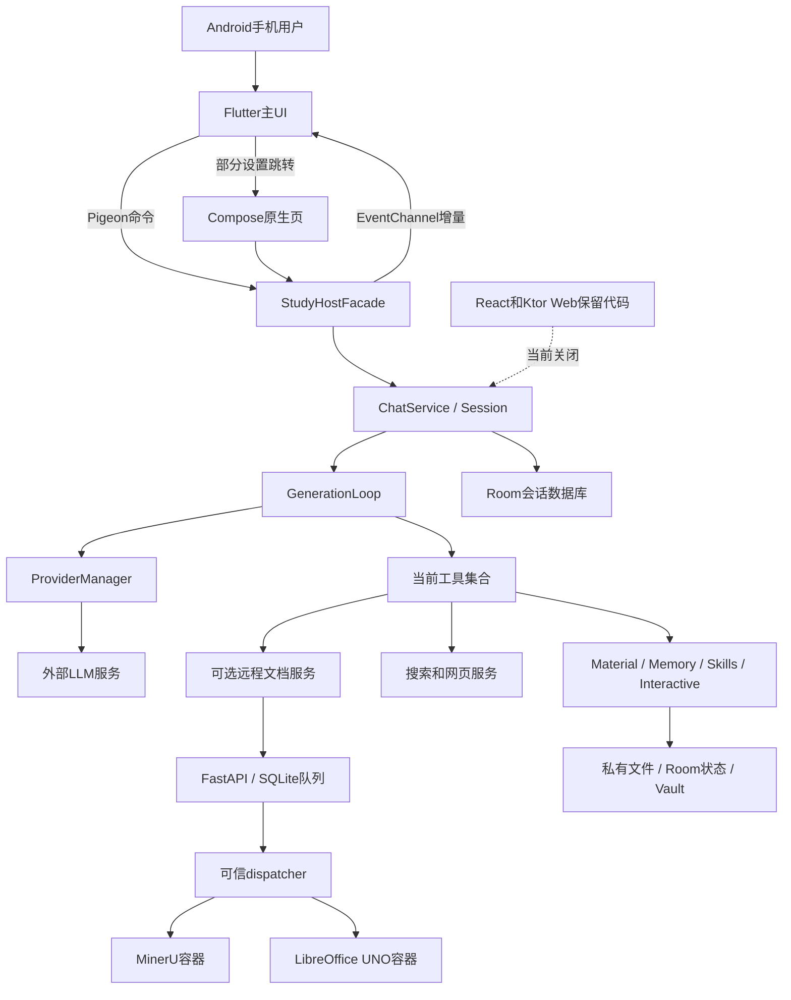
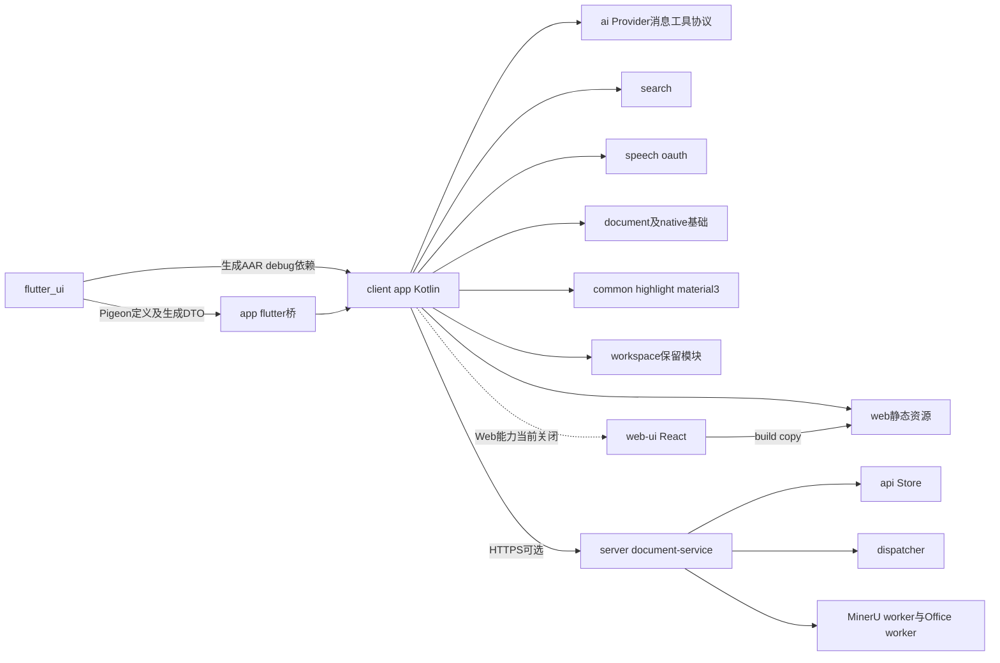
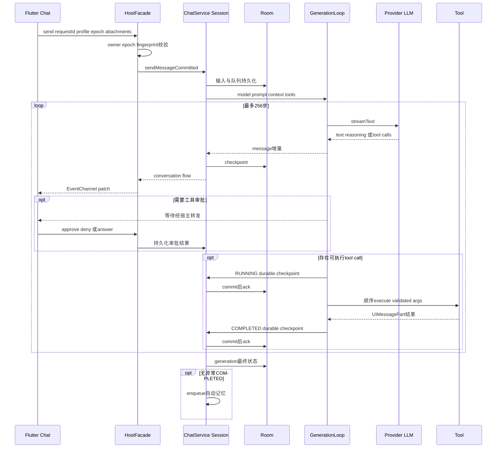
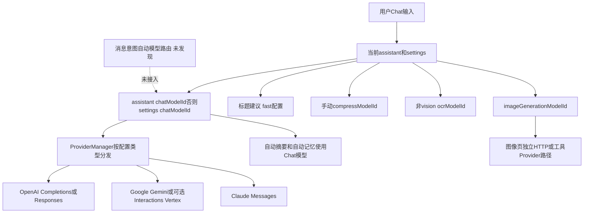
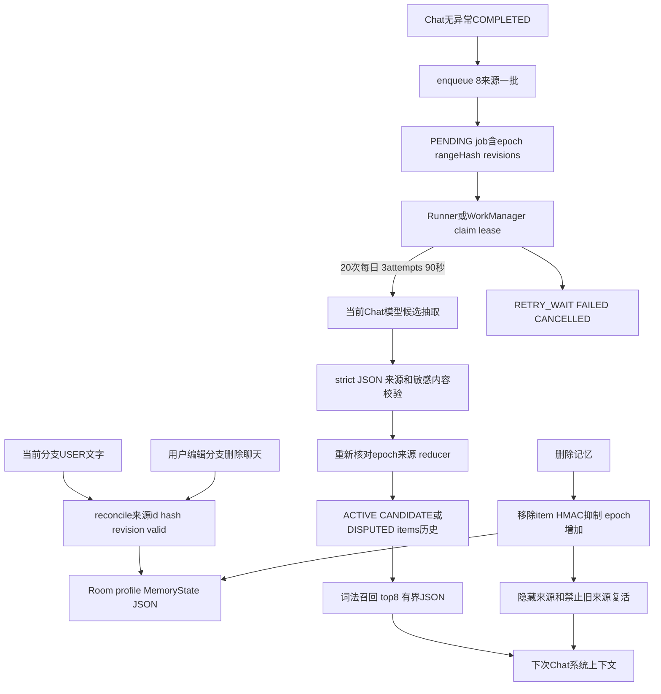
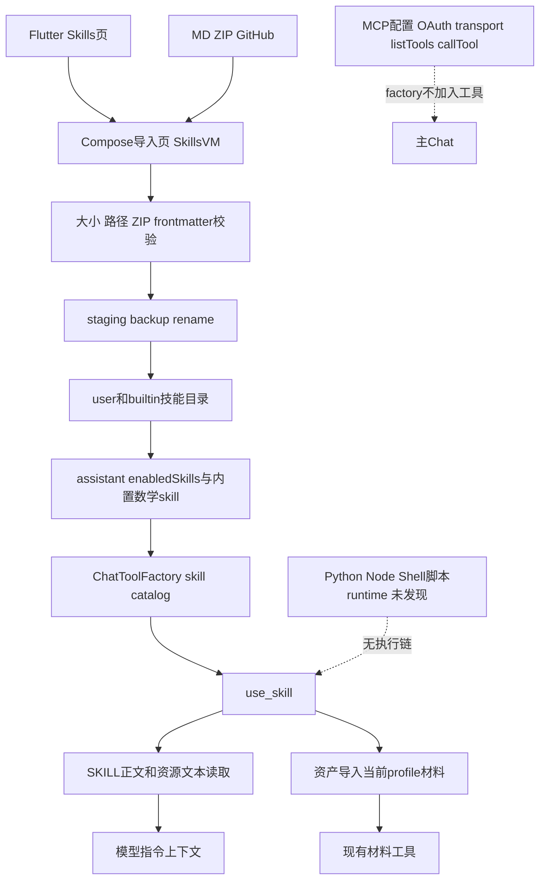
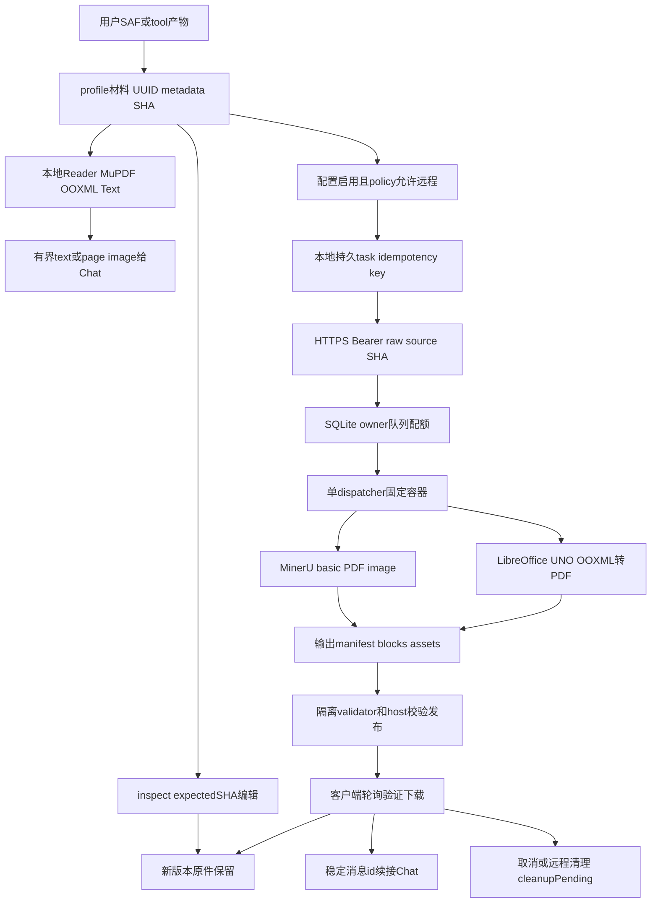
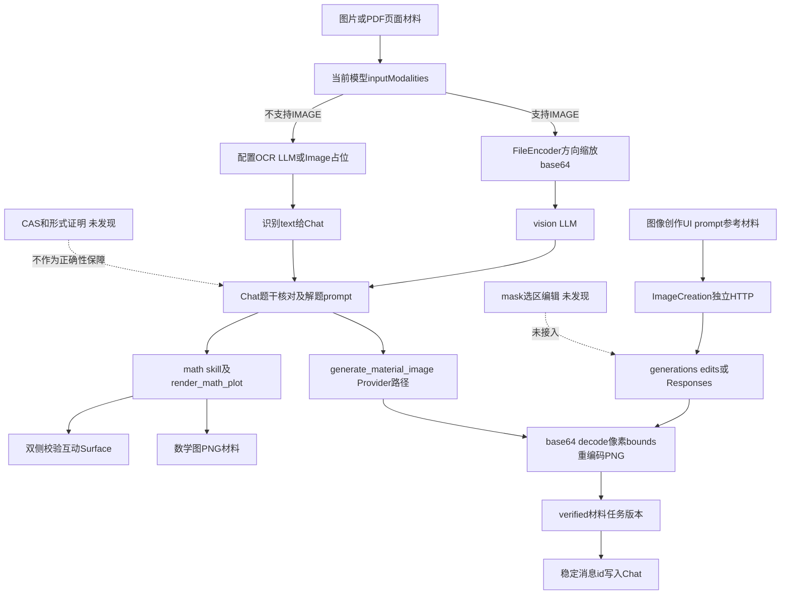
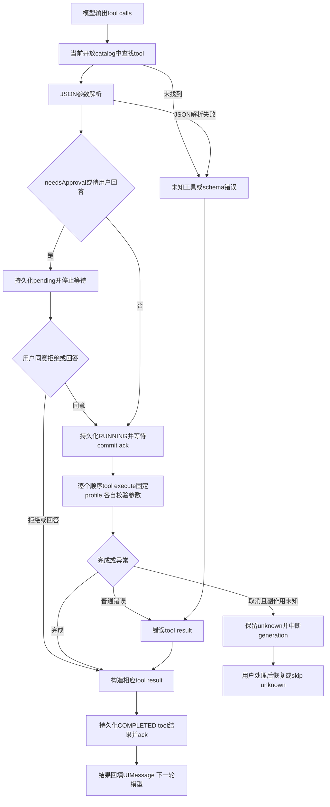
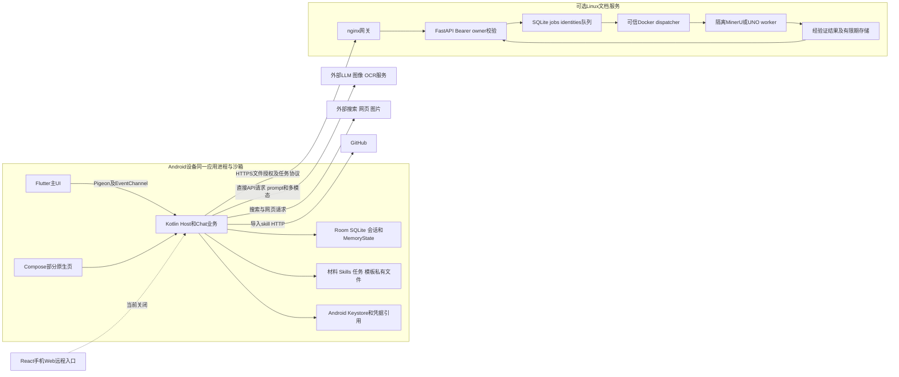

# AI Agent 项目现状调查完整报告

审计日期：2026-10-11（Asia/Taipei）。审计对象：`D:/Office/Study/code/MathStudyAgent` 当前工作树。性质：只读现状调查；本报告不包含新架构设计或实施计划。配套摘要：`PROJECT_CURRENT_STATE_SUMMARY.md`。

## 1. 调查范围、方法与证据规则

本次先识别仓库、入口与依赖，再逐层追踪 Flutter → Android 宿主 → ChatService → GenerationLoop → Provider/工具 → 持久化 → UI，以及文件、记忆、Skills、图像、远程文档任务的旁路。分析依据为当前源代码、构建声明、测试源码、选定的历史验证报告；README 只用于对照。没有调用模型、访问生产服务、上传代码、启动应用、安装依赖、构建 APK、运行会改写产物或数据库的测试。

结论使用两个独立维度，避免把“代码存在”混同于“线上可用”：

| 证据等级 | 本报告中的含义 |
|---|---|
| 已验证 | 直接代码证据或本次安全只读检查；若无特别说明，指静态实现已确认，**不代表本次真机运行通过** |
| 部分验证 | 已确认部分入口/实现，但端到端、配置或外部运行条件未验证 |
| 代码推断 | 根据调用关系、条件和数据结构推导的影响，未经实际复现 |
| 无法验证 | 缺少设备、有效配置、生产访问或安全运行条件 |
| 未发现实现 | 在指定相关目录、调用点和关键字检索中未发现有效实现，不作绝对不存在的断言 |

功能状态另用“已接入 / 部分接入 / 保留但停用 / 禁用或占位 / 未发现”。矩阵中的“已接入”表示存在可追踪的现行执行链，仍受用户配置和外部服务影响。代码证据编号 E01–E70 在第 18 节给出完整相对路径、行号和符号；正文中的编号均指向该索引。同一编号可覆盖一组共同实现某条链路的文件。

没有读取真实密钥、签名配置值、设备私有数据库、聊天记录、Cookie、模型输出原始日志或服务器认证文件。第三方依赖、构建缓存、大型二进制及大量 QA 原始输出不逐个审阅。主要自有业务代码深读，其余模块作入口、依赖和用途审查，具体边界见第 23 节。

### 1.1 仓库快照与只读基线

根仓库分支 `master`，HEAD `f603719909f342fabfcedf5c9a0cfcb9116194bd`；根仓库 `git remote -v` 没有输出。本次结论对应**包含大量未提交修改的工作树**，不是该提交的纯净版本。基线 `git status --porcelain=v1 -uall` 共 8,378 项：192 个 ` M`、23 个 ` D`、8,163 个 `??`。这里是 Git 路径状态项数量，不能直接解释为业务代码变更数量；未跟踪项包含产物等。

没有切换分支、提交、暂存、回滚、清理、更新 submodule。`client/.gitmodules` 声明 Material Color Utilities 子模块，但本次没有发现另外可独立操作的嵌套 `.git` 目录；不因此假设第三方子模块状态正常。基线源码/配置/文档选集指纹覆盖 1,850 个文件，排除缓存、QA 原始输出、审计目录、私密配置及部分二进制/第三方源码，SHA-256 为 `4f74aa325070f9f21a5cc4527a16bd9beba7d457048cfb428b81318549669a33`。完整 Git 状态文本的基线 SHA-256 为 `c6e7c4ea6a4705e30f019478755dcfbad6ad103a7052607d964ab479b4926857`。交付前一致性检查见第 23 节。

## 2. 项目定位与真实运行形态

**已验证**：这是从 RikkaHub Android 工程演进的、以 Android 手机为主的 AI 聊天与工具应用。Gradle 工程名和大部分 Kotlin 包仍为 `rikkahub` / `me.rerere.rikkahub`，当前应用 ID 为 `org.hxsi.agent`，版本声明 `0.1.0-dev`。`MathStudyAgent` 是工作区名称；教学领域能力通过提示词、学习档案、记忆和数学可视化接入通用 Chat，而不是一个独立数学求解后端。[E01–E04、E13]

当前启动界面为 Flutter Add-to-App 的 `StudyFlutterActivity`；核心 Agent、数据库、文件与凭据控制留在 Kotlin 宿主。原生 Compose 页面继续承担部分设置、Skills 导入、备份等流程。React Web UI 和手机内 Ktor Web 服务源码保留，但当前能力开关关闭。另有独立 Linux Python 文档服务，其职责是 MinerU 基础解析和 LibreOffice 排版转换，**不是通用聊天服务端**。[E04–E06、E45、E52–E57]

没有发现独立 Work 模式。`StudyMode` 实际是 `CHAT / GUIDED / HINT / CHECK / EXPLAIN`，用于教学回答风格；不能视为 Chat/Work 双工作区。现行系统具有多轮工具循环、持久化检查点、审批暂停和恢复，已超出一次模型回复，但没有发现独立任务规划器、任务 DAG、工作流编排引擎或自动模型任务路由。[E09–E13]

## 3. 工作区结构、模块职责与规模

| 目录 | 实际职责及关系 | 调查判断 |
|---|---|---|
| `client/app` | Android 宿主、Compose 旧界面、Flutter bridge、ChatService、业务、Room、文件与后台任务 | 当前业务核心 |
| `client/flutter_ui` | Dart/Flutter 主界面，Riverpod、GoRouter、数学 Markdown、交互 Surface；Pigeon 定义及生成代码 | 当前主要产品入口 |
| `client/ai` | Provider 协议、模型能力、消息/工具/usage、流式解析、多模态编码 | Kotlin 宿主直接依赖 |
| `client/search` | 多搜索服务商实现、网页/搜索相关 DTO | Chat 的外部搜索能力 |
| `client/speech`、`client/oauth` | ASR/TTS、OAuth/服务账号授权等基础能力 | 有真实实现；部分入口深入程度较低 |
| `client/document` | 历史本地文档/原生解析基础，包含第三方或 native 依赖 | 与新 `feature/material` 不应混为一条链 |
| `client/workspace` | 历史 workspace、native/沙箱执行基础 | 当前 Chat 不暴露共享 workspace 工具 |
| `client/web`、`client/web-ui` | 嵌入式 Web 静态资源、React SPA，与 app 内 Ktor 路由配套 | 保留但当前运行入口关闭 |
| `client/highlight`、`common`、`material3` | 高亮、通用 UI/Android 工具、颜色主题 | 支撑模块，非独立 Agent |
| `client/videogen` | 视频服务商协议/模型 | 源码存在，不在当前 Flutter 主 Agent 工具链 |
| `client/build-logic`、`app/baselineprofile` | Gradle 构建约定、性能 profile 工程 | 构建辅助 |
| `client/locale-tui`、`trace-cli` | 本地化/诊断命令行辅助 | 开发工具，不是线上 Agent 服务 |
| `server/document-service` | FastAPI、SQLite 队列、可信 dispatcher、MinerU/Office worker、Docker/systemd/nginx 脚本与测试 | 独立可部署文档服务 |
| `scripts` | Android/Flutter 构建、检查、QA 与部署辅助脚本 | 只读检查，不执行 |
| `docs` | 设计、阶段记录、构建说明、当前状态及历史报告 | 用于代码对照，不作功能真实性单独证据 |
| `qa` | 历史验证报告、测试数据、截图与原始输出 | 选读脱敏汇总；不读取私人原始日志 |
| `.local`、`tmp`、构建/依赖目录 | 环境、缓存、临时与生成产物 | 不作业务实现依据 |
| 根目录独立 HTML 绘图演示 | Doraemon/Pelican 等演示页面 | 未发现进入当前 App 的有效调用 |

E01 的 `include` 明确 Gradle 子模块关系。Flutter 不作为独立 Gradle 子项目直接承载业务，宿主使用其生成 AAR 的本地 Maven 仓库。Web 打包脚本把 SPA 产物复制到 `client/web/src/main/resources/static`，不是独立云 Web 后端。[E01、E03]

### 3.1 自有代码规模口径

以下为本次只读脚本统计 `.kt/.dart/.ts/.tsx/.py/.kts/.ps1/.sh/.bat` 等选定扩展名；排除 build、依赖、生成 bridge、vendor、QA 及部分 native/Java 代码。包括测试源与构建脚本，因此不是生产 LOC 或覆盖率。

| 子目录 | 文件数 | 行数 |
|---|---:|---:|
| `client/app` | 651 | 117,347 |
| `client/ai` | 71 | 16,789 |
| `client/flutter_ui` | 115 | 28,214 |
| `client/web-ui` | 119 | 15,685 |
| `client/highlight` | 52 | 9,910 |
| `client/speech` | 48 | 5,430 |
| `client/search` | 32 | 4,612 |
| `client/workspace` | 12 | 2,002 |
| `client/locale-tui` | 19 | 1,855 |
| `client/document` | 7 | 1,114 |
| `client/videogen` | 11 | 1,020 |
| `client/oauth` | 7 | 996 |
| `client/trace-cli` | 9 | 759 |
| `client/web` | 4 | 154 |
| `scripts` | 54 | 3,283 |
| `server/document-service` | 32 | 2,354 |

小型 build-logic/material3/root 配置另计。测试目录文件统计约为 app 141、ai 29、Flutter 36、search 9、server 14；其中包含辅助脚本/fixture，**不能称为对应数量的测试用例**。

## 4. 技术栈、依赖与构建部署现状

### 4.1 Android 与 Flutter

**已验证（声明值）**：Android minSdk 26、targetSdk 37、compileSdk 37、Java 17，ABI arm64-v8a / x86_64 并有 universal APK。Version Catalog 声明 AGP 9.4.0、Kotlin 2.4.20、Compose BOM 2026.09.00、Room 2.8.5、Koin 4.2.2、DataStore 1.2.1、OkHttp 5.5.0、Ktor 3.5.2、coroutines 1.11.0、serialization 1.11.0、WorkManager 2.11.2、QuickJS 1.0.15、MCP SDK `0.15.0-rikka.2`、SnakeYAML 2.7。这些是当前源码声明，不是本次下载、解析或验证通过的依赖版本。[E01–E03]

Flutter `pubspec.yaml` 声明 Dart SDK `^3.13.5`、flutter_riverpod `^3.4.3`、go_router `^18.0.2`、flutter_math_fork `^0.7.4`、flutter_markdown_plus `^1.0.12`、fl_chart `^1.2.0`、Pigeon `^29.0.7`。数学排版、图表和状态管理均有真实消费点；声明依赖不等于完整功能已上线。[E03、E06、E44]

构建约束：宿主 `app/build.gradle.kts:326` 只有 Flutter `debugImplementation(...flutter_debug...)`，没有找到对应 release 依赖；Launcher/主源码却使用 Flutter 类型。**已验证**是依赖声明不对称；**代码推断**是 release 构建/分发链存在未闭合风险。本次没有运行 release，不能断言某条 release 命令必然失败，也不能把历史 debug 真机结果推广为 release 可用。[E02、E04]

Gradle 还读取本地签名参数 `storeFile/storePassword/keyAlias/keyPassword`，本次未读其真实值。Flutter AAR 依赖本地仓库产物，普通 `assembleDebug` 说明不足以单独证明全新环境可重现。当前 Add-to-App Android 形态也不证明独立 iOS 应用已经发布。[E01–E03]

### 4.2 React、Python 与服务端依赖

React SPA：React 19.2.4、React Router 7.13.0、TypeScript `^5.9.2`、Vite `^7.1.7`、Tailwind `^4.1.13`、Zustand 5.0.11、TanStack Query、ky 1.14.3、Shiki、KaTeX。`react-router.config.ts` 关闭 SSR。`package.json` 中 typecheck 会生成类型，lint 自带 `--fix`，build/copy 会覆盖静态目录，故没有以“只读验证”名义执行这些命令。[E03、E45]

文档 API 声明 FastAPI 0.142.2、uvicorn 0.54.0、python-multipart 0.0.32、httpx 0.28.1、Pillow 12.3.0；解析 worker 声明 **MinerU 4.0.10**、pypdf 6.19.0，有独立哈希锁文件。Docker worker 设置模型目录和离线环境，模型权重本体及来源安装状态未验证。Office worker 使用 apt 安装 LibreOffice Writer/Calc/Impress/Math、python3-uno、字体，再通过 Python UNO 控制排版导出；历史 QA 记录过 **LibreOffice 25.2.3.2**，不代表当前生产部署或未来 apt 重建一定还是此版本。[E52、E56–E57、E69]

没有发现当前文档后端使用 Redis、Celery 或分布式消息代理：SQLite jobs + 单 dispatcher 是真实队列实现。Python API、dispatcher、worker 是同一服务仓库的不同信任/进程边界。[E53–E56]

### 4.3 环境与部署变量

| 名称/配置入口 | 用途 | 本次确认范围 |
|---|---|---|
| Android `local.properties` 的签名参数名 | APK 签名 | 只看引用，不读取值 |
| Provider 的 `apiKey/baseUrl`、模型 UUID/能力 | 外部 LLM、图像、OCR 模型选择 | 代码字段已确认，设备实际值未知 |
| 文档服务 `enabled/baseUrl/credentialReference` | 每学习档案远程解析/Office 服务配置 | 保存在 noBackup 配置，凭据由 Vault 引用 |
| `MATHDOC_DATA` | API/dispatcher 数据根目录 | 服务端代码确认 |
| `MATHDOC_WORKER_IMAGE`、`MATHDOC_OFFICE_IMAGE` | dispatcher 启动的固定 worker 镜像 | 读取变量名，未读取服务器 env 文件 |
| `BASE_IMAGE` | 两种 Docker 构建基础镜像参数 | 必需构建输入，不自行推断线上值 |
| `MINERU_CONFIG`、`MINERU_HOME` | MinerU 配置/模型目录 | worker 镜像/挂载声明 |
| `HF_HUB_OFFLINE`、`TRANSFORMERS_OFFLINE`、`HF_HUB_DISABLE_TELEMETRY` | 离线模型与遥测配置 | Docker 环境声明，不代表已有全部权重 |
| Office `HOME`、`LANG`、`SAL_USE_VCLPLUGIN` | 临时用户目录、字符集、headless 渲染 | Docker/UNO 实现 |
| systemd `EnvironmentFile` | dispatcher 镜像配置文件 | 仅路径与用途，未读内容 |

部署脚本使用 Linux 用户、venv/uv 哈希依赖、Docker、systemd 和 nginx；API 绑定 loopback 8766，nginx 为外部入口。API unit 有限制权限、内存/CPU/Tasks；dispatcher 因 mount/tmpfs 和 Docker 是可信宿主控制层，不能把容器里的非 root worker 与宿主 dispatcher 的权限等同。仓库有 TLS/网关部署与回滚逻辑，但没有登录生产机或验证证书、域名、服务状态。[E56–E57]

## 5. 总体架构与启动生命周期

实际控制路径分为四层：Flutter 产品 UI → 同进程 Kotlin 宿主业务 → 外部模型/搜索/可选文档服务 → 本地数据库和私有文件。主 Chat 没有“Flutter 发 HTTP 到 Python Chat API”这一步。

`AndroidManifest` 的 Launcher 是 `StudyFlutterActivity`；`RikkaHubApp.onCreate` 在 Koin eager 单例/worker 之前尝试应用待恢复备份，随后安装诊断、初始化依赖注入、启动记忆 Runner、安排两个 WorkManager 任务、建立通知通道、清理临时/历史工具输出、提取内置 Skills。[E04]

`StudyFlutterActivity.configureFlutterEngine` 注册 Pigeon Host API、`study_events` EventChannel、appearance/external_links/frontend_features MethodChannel、文件选择与保存回调。外链仅接受 HTTP/HTTPS；Android SAF 返回的 URI 进入宿主管理的材料库。销毁时取消待选文件和 facade scope。[E05]

Flutter `main` 加载外观配置，创建 ProviderScope/MaterialApp.router；恢复前台时刷新 bootstrap、材料、记忆、文档、artifact、图像数据。GoRouter 初始 `/chat`，还有图像、聊天检索、文件/详情/符号核对、artifact/版本、Provider/模型、Skills、记忆、文档任务、外观、备份、诊断等页。存在 route 不等于所有页都有独立原生新实现，Skills 导入和备份会跳到 Compose 页面。[E06、E29、E46]

这些初始化会触发清理/迁移/任务，故本次没有启动 App 来验证 UI。当前 app 数据路径、服务 ready marker 和生产配置没有被实际打开；报告描述的是生命周期代码。

## 6. 主要模块的实现边界

| 模块 | 输入 → 处理 → 输出 | 当前边界 |
|---|---|---|
| Chat 宿主 | DTO/已有会话 → owner/epoch/幂等校验 → 持久化输入/生成 Job → 展示事件 | 主要编排在 Android，不是云服务 |
| Agent 循环 | 有限历史、系统提示、工具集合 → 模型工具决策 → 顺序执行 → tool result 再输入模型 | 256 步上限；无独立 DAG planner |
| Provider | 统一 UIMessage/Params → 各协议请求与流式解码 → UIMessagePart/usage | 三类协议；能力声明需配置，不作自动实测 |
| 材料 | URI/工具生成 → 校验、私有副本、元数据、读取/新版本 → artifact 卡片 | 固定 profile 权限；支持范围分格式 |
| 远程文档 | 明确来源文件 + 页范围 → 持久任务/上传/轮询/哈希下载 → blocks/assets/新材料 | 默认配置关闭；有单独用户传输规则 |
| 学习记忆 | 用户文字来源 → 异步候选抽取 → 严格校验/冲突 reducer → 词法召回 | Room 每 profile JSON；不是向量 RAG |
| Skills | MD/ZIP/GitHub → 有界、安全目录安装 → enabled catalog/use_skill → 指令和资源 | 没有脚本执行环境或依赖安装器 |
| 数学交互 | 模型 JSON → Kotlin/Dart 校验 → 曲线/表格/控件 + PNG材料 | 表达式解析/采样与展示，不是 CAS/proof engine |
| 图像创作 | prompt/ref IDs → 固定配置模型 HTTP 请求 → PNG验证、任务、材料、Chat插入 | 付费请求中断不自动重放；无 mask 选区链 |
| DB/凭据/备份 | 会话树/配置/文件 → Room/私有目录/Vault → 本地浏览/恢复 | 凭据加密与备份加密；一般材料/DB非统一密文存储 |

对应证据分别见 E07–E24、E25–E43、E47–E58。上表不是新增组件划分，而是对当前调用和数据归属的归纳。

## 7. 核心执行链与 Agent 机制

### 7.1 一条用户输入到回答的完整链

1. Flutter `ChatPage._handleSend` 快照当前文本与 attachments，调用 Riverpod notifier 的 `sendMessage`；成功且 profile/epoch 仍匹配才清空输入。[E06]
2. notifier 保存可重试请求；只有 profile、epoch、conversation、内容与附件都相同才复用 requestId。`BridgeClient` 调用 Pigeon，不经过 Web HTTP。[E06–E07]
3. `StudyHostFacade.sendMessage` 校验 active profile/contextEpoch、会话归属、文本/附件和同会话图像任务状态，使用 `profileId:requestId` 生成稳定输入 UUID，以内容指纹/receipt 拒绝同 ID 不同内容；新会话也有确定性 ID。附件必须是属于该 profile 的 verified 材料。[E07]
4. façade 初始化会话、更新教学模式，调用 `ChatService.sendMessageCommitted`；会话输入/队列通过 `ConversationSession` 持久化，进入 generation job。[E08–E10]
5. `handleMessageComplete` 取 assistant 或 settings 的 Chat 模型，获取 Provider，构造固定 profile 的工具集、学习记忆上下文和消息 transformers，再调用 `GenerationLoop.generateText`。[E08、E11–E12]
6. 循环构造 prompt/历史、检查预算、调用 Provider 的 streamText，模型返回普通内容或 function calls。没有工具调用就完成；有工具则校验参数，按需暂停审批，按顺序执行，结果附回该 assistant 的 tool parts，再发下一轮模型请求。[E11、E14–E17]
7. `DurableCheckpoint` 必须先落盘，再 ack 给循环。普通消息增量也写入会话；完成/取消/失败状态进入持久化。只有无异常的 COMPLETED 才 enqueue 自动记忆；标题/建议是另行后台任务。[E08–E11、E23]
8. facade 监听会话/生成状态，发 `conversation_changed` 或 `message_patch`；Flutter 按 profile、epoch、sequence 筛选，gap 重新取详情，40ms 合并增量后渲染文字、思考、工具、图表、材料卡。[E07、E44]

### 7.2 意图、规划、工具选择与并行性

**已验证**：工具选择主要交给当前模型，在工具描述/系统提示、模型 TOOL 能力和本次开放 catalog 下进行 function calling。外部搜索在 factory 中无条件提供，不再由旧 `enableWebSearch` 一类标志决定；能否被模型正确调用仍受模型协议/能力控制。[E12、E17]

**未发现实现**：独立意图分类服务、数学/文件/日常 Chat 自动分类器、按任务难度/价格/模态自动选模型、规划 DAG、自主修改工具集合、独立执行工作区、跨设备多 Agent 任务系统。在 factory、模型选择、循环和 Flutter route 检索中没有有效接入。

**已验证**：循环支持多轮调用、暂停恢复、AskUser、人工同意/拒绝、持久化执行状态。一个 response 的 tool calls 由 `forEach` 顺序处理；没有发现这条 Agent 路径并行执行工具。Coroutine/后台 Job 的存在不等于并行 tool execution。[E09–E12]

因此当前最准确的描述是：**带持久化控制与多步 function-calling 循环的 Chat Agent**。它有执行循环；“规划”主要由 LLM 内容和工具选择形成，未体现独立可验证任务计划。它不具备已确认的自动模型路由，也不足以仅凭现状称为复杂任务执行平台。

### 7.3 审批、错误、重试、取消和恢复

工具定义支持 `needsApproval`，默认 false。只有声明需要审批的工具才触发等待；本地材料工具/读取 Skills 不是每次人工审批。AskUser 回答作为工具结果进入下一轮。控制层按固定 owner 校验会话/材料，不能仅根据模型传来的 profile 字符串切换资源。[E07、E12、E14、E30]

执行前先持久化 RUNNING 检查点，执行后写 COMPLETED 结果再继续模型。取消传播 `CancellationException`。有潜在副作用的执行中断会保留未知状态并停止；恢复默认不重放未知工具，用户可选择跳过并记为 `SKIPPED_UNKNOWN`。进程重启把尚在生成的记录改为 INTERRUPTED；这不是保证模型/付费外部请求 exactly-once，也不是无损继续旧网络 stream。[E09–E11]

模型流层对特定 `IOException` 最多重试 3 次，指数等待约 1/2/4 秒；已经收到 chunk 的部分 stream 不自动重试。不能将其扩展为所有 HTTP 状态、工具、模型和 Provider 的统一 fallback。网络路由变化会取消生成 scope，失去网络有 750ms 检查；这属于停止/明确恢复行为。[E11、E58]

无统一所有任务 wall-clock deadline 或全局 token/金额预算的证据。循环有 256 步限额，压缩、记忆、文档、图像请求有各自超时。标题、建议、记忆、文档同步和前台生成各有 scope/Job/WorkManager；Android force-stop、电池限制、后台网络并不能由 WorkManager 声明保证即时执行。[E08、E11、E23、E37、E40]

### 7.4 流式协议与输出限额的特别说明

Provider 层 OpenAI SSE、Google/Claude 的协议流由 Kotlin 解码。Flutter 接收的是 **EventChannel 事件**，含 `apiVersion=1.0/type/profileId/contextEpoch/timestamp/sequence/payload`，不是 SSE。保留 Web 模块另有 HTTP/SSE 路由，但当前开关关闭。[E07、E17、E45]

`GenerationLoop.maybeTruncateToolOutput` 虽有约 32Ki 字符阈值，但 `!hasShellAccess` 时原样返回；当前 factory 不提供 `workspace_shell`。**已验证**：这条通用截断在当前主 Chat 工具集合中不生效。分页工具各自限流仍有效，不能声称所有工具结果都有统一 32K 上限。其可能增加上下文压力属于代码推断。[E11:635–667、E12:78]

## 8. 智能 Chat 的详细现状

### 8.1 智能行为的组成

目前“智能”来源于：通用/教学提示、学习记忆召回、搜索与网页内容、材料读写/转换、数学可视化、Skills 指令加载、交互 JSON Surface、多轮工具反馈和可靠输入/恢复控制。没有找到与此另立的“普通 Chat → 自动路由智能 Chat”的服务入口。同一会话共享模型/assistant/历史，不同任务不会自动开辟 Work 上下文。[E08–E13、E21–E44]

教学模式追加 `StudyLearningLoop` 诊断、练习、记录、复习规则，但其本质是提示词约束，不是独立教学状态机。学习成绩/掌握度必须由记忆 evidence 规则限制；不能把 AI 自己讲完题当用户掌握知识。[E13、E21–E24]

### 8.2 系统提示与输入输出变换

`GenerationLoop` 按 assistant prompt 或允许的 conversation override 形成基础系统提示，结合 StudyTutorDefaults、非 CHAT 教学模式、learningMemoryContext、实际保存记忆的限定说明、材料调度 guidance、搜索/图像/交互提示，以及各工具的 systemPrompt。提示常量分布于多个 Kotlin 文件，未发现集中 prompt release/version 管理器。[E11:389–449、E13]

ChatService 输入 transformers 包含时间提醒、PromptInjection、Placeholder、OCR，然后追加 DocumentAsPrompt 与 Template。输出包括 ThinkTag、Base64 图片落盘、Regex。文件文本以 untrusted 数据边界/来源 ID/hash/coverage 组织；这提供可追溯约束，但不能证明 prompt injection 已被完全消除。Skill 本文也会进入模型指令语境。[E08:149–163、E31、E42]

### 8.3 历史与长上下文

会话是 message nodes + selected branch，编辑、再生成、分支选择改变当前历史。用户删除学习记忆所涉及的 hidden source message IDs 在 prompt 构造阶段过滤；空响应检查点不发送。普通 `assistant.contextMessageSize` 先限制历史。[E09、E11:432–438、E22]

`ChatContextBudget` 用字符近似估算 token（ASCII 约 0.35/字符、非 ASCII 约 1.5，图片固定估值），默认预算 16,000，设置范围 4,000–64,000；不是模型 tokenizer。缓存键包含 profile/conversation，指纹关联模型、系统提示和历史。保留系统与近期完整 USER turns，不能压缩悬而未决的工具 turn；单 turn 过大可直接报错。[E20]

自动压缩以当前 Chat Provider/模型、无 tools、maxTokens 1800、每批 60 秒生成摘要，批次数量受限；摘要有 12,000 字符上限，估算后仍超预算会拒绝继续。手动 `compressConversation` 使用 settings.compressModelId，是另一条路径。没有发现根据 Model 真实 context window 自动设预算；Model DTO 也没有 context-length 字段。摘要模型调用的 usage 没有同主回复合并为完整费用账本的已接入证据。[E08:1116、E11:469–497、E17、E20]

### 8.4 联网、思考与复杂输出

外部搜索和网页读取存在实际实现；默认 Bing 路径不需该搜索 API key，但不同 search provider 可能要求独立配置。网页读取、搜索候选、图片展示都只是信息来源，不承担事实裁决。WebPageReader 有 public DNS/IP/port/redirect 检查及大小限制；WebImageService 有 scheme/host/userinfo、大小/解码与并发限制，但没有沿用 PageReader 的 public DNS/IP 和逐跳 redirect 防护，二者不能混写为同一安全保障。未实际访问所有服务商或验证内容正确性。[E12、E41]

Reasoning、Tool、Text、Image、Document 是真实消息 part。Flutter 主页面按这些类型渲染，工具结果可以是 markdown、artifact、数学 plot 或受校验的 interactive surface。支持卡片、表格、line/bar/scatter、slider/select/button/calculation、函数/参数/隐式图形；不是允许模型任意执行 HTML/CSS/JS 页面。[E14、E43–E44]

消息编辑、重新生成、选分支在 ChatService 有真实操作并经 bridge 暴露。forkConversation 后端/原生代码存在，主 Flutter 独立 fork 入口未完全确认，矩阵列为部分接入。ChatPage 的复制是真实 Clipboard 操作；另一个 `message_bubble.dart` 中 copy/feedback/TTS TODO 未找到主页面使用，不能据此指控当前复制按钮是假实现。[E08:581、1468、1516、1572；E44]

### 8.5 上下文隔离与现有可复用边界

学习档案、会话、材料、学习记忆、远程任务以 profile 隔离；epoch/sequence 防止前端旧异步结果污染切换后的界面。profile 切换先暂停队列/停止生成并持久化选择。模型/assistant 配置、Skills 库与部分启用关系仍是共享配置，不应把“profile 文件隔离”泛化为每 profile 完全独立的所有系统设置。[E07–E10、E19、E25]

对未来 Work 的现状边界：Provider/Tool/UIMessage、材料与版本、远程任务、审批检查点、交互 schema、profile owner 校验都已有可识别接口；但 ChatService 把 prompt、模型选择、状态、自动记忆、生成媒体和 UI 事件关联在一起，StudyHostFacade 汇集众多领域入口。现有 `ConversationSession`、assistant/conversation UUID、Flutter conversation providers 是关键耦合点。这里描述现有边界，不提出新 Work 实施方案。

## 9. 模型接入、路由与调用体系

### 9.1 Provider 与模型配置

`ProviderManager` 注册 OpenAI、Google、Claude 三种协议适配器。OpenAI-compatible endpoint 并不等于只允许 OpenAI 公司服务；具体运行服务商由配置 baseUrl 决定。当前设备启用了哪些服务商/模型/key 未读取，**无法验证实际配置名单**。`ModelRegistry` 有 GPT 等家族的名称规则与能力默认值；这是能力推断注册表，不是线上已配置模型列表。[E15–E18]

| 适配器 | 代码中的请求能力 | 当前不能推断的内容 |
|---|---|---|
| OpenAI | Chat Completions 与可选 Responses、stream/nonstream、models、embedding、image generation/edit | 每个 compatible endpoint 都支持所有协议；实际账号可用模型 |
| Google | Gemini generateContent/stream；可选 Interactions；Vertex 路径及服务账号 Token | 默认 flag 关闭时实际走 Interactions；所有 Gemini 模型都能执行每项工具 |
| Claude | messages/stream、pause-turn 等协议处理 | 原生图像生成：实现明确报不支持 |

ProviderSetting 定义默认 endpoint、Responses/Interactions flag、自定义 header/body 等。Model 有 UUID、modelId、displayName、CHAT/IMAGE/EMBEDDING、input/output TEXT/IMAGE、TOOL/REASONING、内置 Search/UrlContext/ImageGeneration、providerOverwrite。能力配置/名称 registry 不代替实际联通测试。[E16–E18]

### 9.2 模型选择与自动化范围

主回复取 `assistant.chatModelId ?: settings.chatModelId`；标题/建议用 fast model 类配置；手动压缩用 compressModelId；非 vision 图片 OCR 用 ocrModelId；图像创作用 imageGenerationModelId；自动学习记忆抽取沿用当前 assistant Chat 模型。它们是**按功能固定配置的模型角色**，没有发现根据一条消息语义自动跨模型选择的 router。[E08、E23、E40、E42]

`ResponseAPI` 处理内置 image_generation 有硬编码 `gpt-image-2`，这是请求实现细节，不能报告为实际用户配置或本次验证可用模型。TTS 默认 `gpt-4o-mini-tts` 也只是 speech 配置，并非数学题默认解题模型。[E17、E19]

没有找到 Provider 失败自动切备用服务商、模型自动降级、按成本/延迟智能路由。多 API key 的 KeyRoulette 选择与轮换属于认证 key 行为，不应当作智能模型路由。连接层重试与 generation 重试也不保证自动选择不同模型。[E11、E15–E19]

### 9.3 参数、计量与运行约束

统一 TextGenerationParams 包含温度、topP、maxTokens、reasoning、tools、自定义请求字段等，各 Provider 序列化有不同条件。`TokenUsage` 保存 prompt/completion/cached/total 等并合并流增量；没有发现价格表、每 profile 金额预算、余额结算或覆盖主回复+摘要+OCR+记忆+图像的统一费用账本。部分历史 Provider balance UI 不能证明全链成本治理。[E14–E19]

当前不同业务有不同超时/并发：记忆每日 20 次/每 job 3 attempts；图像同 profile 一个 RUNNING；服务器文档同 dispatcher 单 worker及 owner/global queue limits。它们是局部约束，不能泛化为全应用 global rate limit。

## 10. 学习记忆系统

### 10.1 存储、来源与状态

现行 `LearningMemoryStore` 使用 Room `learning_memory_state(profile_id,payload)`，payload 为 MemoryState JSON：items、sources、抽取 jobs、抑制指纹、processed/used sources、epoch、每日请求数等。不是向量表或图数据库。旧 MemoryRepository/MemoryTools 仍有代码，但因缺 profile ownership 当前 factory 关闭；ChatService 传给循环的旧 memories 为空。[E12、E21–E24、E47]

MemoryType 包括 BACKGROUND、PREFERENCE、PROGRESS、DIFFICULTY、PERFORMANCE、REVIEW_SUGGESTION；EvidenceType 包括 SELF_REPORTED、READ_ONLY、AFTER_EXPLANATION、WITH_HINT、INDEPENDENT_ATTEMPT、UNVERIFIED。每个来源关联 conversation/node/message/content HMAC、revision、用户来源时间与有效性；每条 item 有类型、topic/factKey、status、origin、revision/history/sourceIds。[E21]

`reconcile` 只从当前 selected branches 的非空 **USER 文字**建立来源，更新 hash 与 revision；不把 assistant 回复直接当学生事实。`recordedAtLocal` 使用 LocalDateTime 字符串，没有统一 offset，所以跨时区时间语义不能假设完全明确。来源长度在抽取阶段限 4,000 字符，来源识别本身不是只截断保存 4,000 字符。[E21–E23]

### 10.2 自动抽取与后台可靠性

Chat COMPLETED 后 enqueue，8 个 source 一批，记录 source rangeHash、epoch、expected item revisions。Runner 前台循环约 15 秒、Mutex 串行，activeChats>0 时暂缓；WorkManager 约 15 分钟调度，有网络/电量约束与 worker 总超时。关闭记忆会取消待处理 jobs。daily cap 为设备本地日每日 20 次，lease 180 秒，最多 3 attempts，失败按 attempt 延迟。[E08、E22–E24]

抽取模型为 profile 当前 assistant/Chat 配置，90 秒限时；模型输出 strict schema version 1，拒绝重复 key、未知 source、过多/过长候选以及特定 secret 形式；响应上限 48,000 字符、候选最多 20、content 最多 2,000 字符。附图片来源不能直接升级 PERFORMANCE。校验降低格式/来源错误，不保证候选语义绝对真实。[E21–E23]

提交时重新检查来源有效性/hash、job ownership/lease、epoch 与 item revisions。相同事实内容合并 source/history，互相冲突的自动事实标 DISPUTED；无冲突的非 PERFORMANCE 自述可 ACTIVE，其他候选保留 CANDIDATE。手工/用户已编辑内容不能由自动抽取覆盖。这是一条带事务和版本约束的候选处理链，并非直接把模型一句“我会记住”存库。[E21:122–198、E22]

### 10.3 手工、显式记住、删除与召回

手工记忆有 CRUD、request UUID 幂等、长度及内容校验。显式“记住/重新记住”只在用户文字明确匹配规则时暴露工具，保存内容须是原用户文字的子串并有已知来源；不能接受模型凭空替用户创造新的事实。[E08:824、E22:171–194、243–260]

删除移除对应 item/history，保存 HMAC source/fact/topic 抑制约束，增加 epoch 并取消受影响 jobs；隐藏相关 prompt 来源，阻止旧消息重新抽取复活。新的明确“重新记住”可走受约束的新来源。旧抑制迁移无法可靠恢复时 recoveryBlocked，自动抽取暂停，而不是丢弃删除约束。[E21–E24]

召回是规范化词/同义词/二元片段匹配；背景和偏好有基础权重，其他按 query relevance 排序，只取 ACTIVE + valid，最多 8 项、合计内容约 3,600 字符，拼成带 evidence/time/source metadata 的历史 JSON 上下文，总上限约 4,800。不使用 embedding 相似度或 vector DB，即使 AI SDK 存在 embedding API、依赖目录提及 sqlite-vector，也不是当前记忆 RAG 的证据。[E22:195–240、E47]

删除记忆不是全盘安全擦除：源聊天/其他文件可能仍存在，聊天删除及 backup retention 是不同边界。这里仅确认业务抑制和 item 删除，未验证设备存储残留。MemoryState 单 profile JSON 及长期 sources/history/jobs 增长可能带来读写成本，属于代码推断；当前没有确认全存储尺寸上限或全量保留策略。

## 11. Skills 与 MCP

### 11.1 Skills 安装、解析、启用与调用

SkillManager 管理私有 user skills 目录与独立 builtin 目录，读取有 name/description 的 SKILL.md frontmatter；SnakeYAML SafeConstructor、重复 key/alias/depth/codepoint 限制有明确实现。元数据包括 name、description、compatibility、license、allowed-tools、directory/builtin；没有明确 semver/version pin。[E25–E27]

安装入口支持 Markdown、ZIP、GitHub Contents 下载：本地输入 8MiB、单文件 4MiB、总量 8MiB、Markdown 256KiB、entries 128、深度 8，路径 canonicalization 拒绝越界/重复等；GitHub 的字节资源保留，不只抓 SKILL.md。先 staging，旧目录备份后 rename，新目录失败恢复旧目录。这里有安装事务补偿，不代表已实测所有文件系统断电原子性。[E25–E28]

Flutter Skills 导入页通过 `openNativePage("skills")` 进入 Compose，`SkillsVM` 真正安装，assistant.enabledSkills 决定可用清单。工具 `use_skill` 只接受启用技能名称；默认读取 SKILL.md body（去 frontmatter），按需读取目录内允许文本；`.py/.js/.sh/.ps1/.r` 可以作为文本读取，**没有调用 Python/Node/Shell 执行**。docx/xlsx/pptx/pdf/image/csv 等资产经材料导入并给出 ID/hash/附件，进入现有固定 profile 文件工具链。[E12、E25–E29]

内置 math-visual-explainer 可自动加入清单；Skill 提示和 `render_math_plot` 共同驱动数学配图。user 与 builtin 同名时 user 优先；自动数学技能查找要求 builtin，因而同名导入可能使 automatic builtin match 不再命中，这是代码推断，不是已观察到用户当前安装冲突。[E12:79–95、E25]

### 11.2 Skills 完成度的真实边界

| 能力 | 结论 | 依据 |
|---|---|---|
| 安装/更新同名目录/卸载 | 已接入，静态已验证 | 有界 import、staging/backup rename、配置清理 |
| 列表、兼容状态、启用 | 已接入，静态已验证 | Flutter DTO → native settings/assistant |
| 解析 frontmatter / 加载正文 | 已接入，静态已验证 | SafeConstructor、use_skill |
| 带资源的 skill 被 Chat 使用 | 部分验证 | 有真实 material 导入链；每个外部 skill 的指令可行性未实测 |
| 脚本自动执行/环境与依赖安装 | 未发现当前有效链 | 脚本仅 text read；共享 workspace tools 关闭 |
| allowed-tools 权限沙箱 | 未发现完整 enforcement | 字段解析/展示不等于按 skill 限制工具权限 |
| 兼容性评级 | 部分验证 | regex/资源/脚本声明静态判断，非运行通过证书 |
| Skill 创建/编辑 | 禁用或占位 | `SkillsVM.saveSkill` 返回 false；builtin skill-creator 文本不等于 UI authoring 已实现 |
| 自动语义版本更新、来源签名、依赖解析 | 未发现有效实现 | 目录同名替换无独立版本/签名机制 |

Skills 当前是**指令与资源扩展层**，不是社区代码任意执行平台。QuickJS 的可选宿主工具是另一个固定工具能力，不能据此称所有 Skill 脚本均能运行。Skills 库/assistant 启用关系主要共享，不是每 profile 独立安装生态。[E12、E25–E29]

### 11.3 MCP 源码与当前集成状态

McpManager/McpSessionRegistry 有真实 SDK Client、状态、配置 reconcile、SSE/Streamable HTTP transport、listTools、callTool、OAuth discovery/coordinator、loopback/custom tabs 授权、重连和错误处理。不能简单写成“MCP 没有任何实现”。设置观察者甚至可能尝试连接保存的 MCP 配置。[E45]

但当前 `ChatToolFactory:97` 明确因共享 MCP 缺 profile authorization contract 而不加入工具。Flutter 主设置没有确认完整 MCP 入口；原生 SettingMcpPage 等保留。没有在当前 MCP 相关主路径发现 stdio server 管理、MCP 自有服务端、prompts/resources 完整发现消费链。因此状态是**协议客户端实现保留，当前主 Chat 工具集停用/未闭合**，而不是已可供当前用户使用的完整 MCP 插件系统。[E12、E45]

## 12. 文件、文档与多模态处理

### 12.1 导入与材料库

Android SAF picker → 宿主复制 → `materials/{profile}/{UUID}.{ext}` + `.meta.json`。允许扩展名：docx/xlsx/pptx/pdf/txt/md/csv/json/png/jpg/jpeg/webp/doc/xls/ppt；非空、单文件 30MiB。导入按显示扩展名判断，实际类型验证主要在后续 parser、image decoder 和 server magic 校验；不能称导入阶段已经识别所有文件真实格式。bridge 会把 GIF 当 Image，但当前 import allowlist 没有 GIF，这是支持范围不一致。[E05、E07、E30]

生成/导入过程用 RUNNING 元数据、`.part`、fsync/原子移入、最终 SHA-256/size；只有 SUCCEEDED/verified 才用于关键打开/保存和工具链。重启后的未完成材料变 FAILED。保存通过 SAF 复制，重读目标并验证 digest，过程中检查 profile。元数据、材料文件、Room 会话处于不同持久化边界，不能推断所有跨文件/聊天更新是单一事务。[E30]

### 12.2 本地读取：支持与边界

MaterialReader：单文件 30MiB、严格 UTF-8 文本 1MiB、输出约百万字符；Office ZIP entries 2000、单 XML 4MiB、累计读取 16MiB、拒绝 DTD/entity；PDF 使用 MuPDF text layer，最多 200 页、加密拒绝、有分页覆盖提示。缓存 read-v4 不是对扫描页施行 OCR。[E31]

| 格式 | 当前本地实现 | 明确边界 |
|---|---|---|
| txt/md/csv/json | strict UTF-8 文本读取、分页工具/内容注入 | 编码失败拒绝；不是任意大文件无限读取 |
| PDF | MuPDF text layer + 单独页面 raster 工具 | 扫描/手写/图片公式靠 vision/远程 OCR；文本不能保证数学结构 |
| DOCX | main document XML、段落/表格文本、OMML 文本表示；嵌入图片另读 | 不还原完整 styles、页眉脚注、精确分页 |
| XLSX | workbook relationship、shared strings、sheet/cell reference、类型、公式文本与 cached values | 不是 Excel 计算引擎；合并/样式/图表/日期显示可能不完整 |
| PPTX | presentation relationships 对应的逻辑 slide 顺序与文本 | 不还原完整动画/图表/notes/视觉布局 |
| DOC/XLS/PPT | 可以导入保管 | 当前 MaterialReader 不解析，远程转换也主要只接受 OOXML |
| EPUB 等旧 parser 支持的格式 | 历史 document 模块有实现 | 未确认接入当前材料 allowlist/主工具链 |

`DocumentAsPromptTransformer` 对附件绑定 owner、校验材料、读取可用文字，合计注入 48,000 字符，保留 material_id/name/ext/SHA/coverage/missing pages/untrusted boundary。它不是一次读取全部附件后永远不再产生上下文成本；历史附件仍可能参与后续 prompt 构造和缓存读取。[E31、E42]

工具有 read_material_text_page（24,000 字符/offset）、read_material_word_images（1–5）、read_material_pdf_pages（1–5）、list_material_files、read_material_file 等。页范围和 vision 能力控制比“支持 PDF”描述更精确：同一文件的 text 与 page-image 两条通道可能给模型不同证据。[E32]

### 12.3 真正生成文件的能力

`create_material_file` 生成 md/pdf/docx/xlsx/pptx 真实材料。MaterialWriter 总输入约 60,000 字符，DOCX 可嵌最多 5 张/总 16MiB 图片，并有可编辑 OMML 的有限公式输出。PDF 用 Android PdfDocument/StaticLayout，分页上限 100，长表格可续页并重复表头；不是完整 Office 渲染器，数学原文可能仍是文本形式。[E32–E33]

OOXML ZIP 为手工构造：DOCX 支持基础段落、表格、图片和有限 fraction/superscript/text 公式；XLSX 单工作表、1–1000 行/1–100 列，number/bool/string，字符串 `=...` 不自动变公式，数值精度受限制；PPTX 1–50 简单文字 slides，每页字符/行数有界，没有发现当前 writer 构建丰富图表/动画/图片版式的路径。不能将这些生成能力描述为完全等同 Word/Excel/PowerPoint 编辑器。[E33]

### 12.4 编辑、PDF 操作与版本

`inspect_material_edit` → `edit_material_file` 要求 material ID、expected SHA、operation/spec、预期原文本等，生成新文件，保留原件；MaterialVersions 按 sourceId 追溯版本家族，不是协作 merge/diff 引擎。[E34–E35]

DOCX 简单段落替换只允许可明确定位的文本，没有公式/图片/field/link 或复杂多样式；也支持 DOCX/PPTX 单 text run 替换。XLSX set_cells 一批最多 200 改动，拒绝改 formula cell，其他公式清除旧 cached values 并设置 fullCalcOnLoad，实际重算靠 Office 打开/远程 Calc，不能声称编辑后本地立即算出公式值。PDF page graft 可选择/重组多个源页，有来源/页数限制，但未确认完整保留文档级 bookmarks/forms/metadata。[E34]

**已验证代码差异**：PPTX reader 用 presentation relationships 的逻辑顺序；editor 部分 inspect/replace 使用 `ppt/slides/slide${n}.xml`。**代码推断**：重排过的 PPT 文件，用户可见第 n 页与该 XML 编号可能不一致。SHA/expected text 防止部分误写，却不证明页号语义一致；本次未制作文件复现。[E31:87–102、E34:32–57]

`convert_material_to_pdf` 区分图片/纯文本本地导出与 Office 排版远程转换；`export_material_text_pdf` 明确是提取文本副本，不冒充原 Office 排版。远程结果保留来源 hash、renderer、page count 等。当前 App 不提供任意 Office 样式修改与逐像素 MS Office 相同保证。[E35–E39]

### 12.5 被遗漏过的服务端组件：MinerU 与 LibreOffice

**已验证**：`server/document-service/worker/run.py` 导入 `mineru.parse` / `DataWriter`，调用 parse 的 `tier="basic"`、page_range、`image_analysis=False`。解析 input 为 PDF/图片，页范围最多每次 5、原文最多 200 页，图片解码限制 32M 像素；输出 content/doc JSON 与重编码 PNG assets，保留页码/block id/text/可用 LaTeX/图片。当前 normalization 有 `geometry_unavailable` 等覆盖警告，未输出可靠 bbox 的路径不能宣称有精确几何定位。[E52、E55]

**已验证**：Office worker 运行 headless soffice，通过 UNO 启动/连接临时 profile，readOnly、MacroExecutionMode NEVER_EXECUTE、NO_UPDATE 导入，用 writer/calc/impress PDF filter 导出。XLSX calculateAll，并对大量 formula/错误状态设限；导出固定 print_layout、排除 hidden/notes 等，报告 renderer version、字体列表/缺字体警告、PDF 页数。它是完整 Office 排版转换器的真实外部依赖，不是手机内的 XML writer，也不是数学 OCR 引擎。[E54、E57]

OOXML package 检查拒绝宏、签名、ActiveX/embedded object/危险 external relationships、xlexternalLinks、路径/ZIP/XML 越界。Worker 网络禁用、nonroot/read-only/cap drop/new privileges 禁用、CPU/内存/进程/tmpfs 配额；输出还经过独立容器验证后发布。以上是源代码安全边界，未实测任何 exploit 或生产容器配置。[E54–E57]

### 12.6 用户授权、异步任务与结果回写

DocumentServiceConfig 默认 disabled，需每 profile 的 endpoint/凭据。客户端只允许无 userinfo/query/fragment 的 HTTPS endpoint；同凭据用于多个 profile 有检测约束。文档传输 policy 检查最近人类文字的“禁止远程/允许”等 regex，默认允许（配置启用后）；这是关键词策略，不是通用自然语言授权解析。**只控制文档服务上传**，不阻止普通 Chat Provider 或 OCR Provider 收到其请求中的内容，所以不能把它叫作全应用“绝不上传”的模式。[E36–E38]

客户端先落任务/幂等 key，再上传；大 PDF 顺序拆为多个 5-page 请求。不确认上传结果的任务不会由后台盲目重传；需要 foreground/policy 允许恢复。下载 manifest/assets 均验证 ID、SHA、size、覆盖与路径，清理失败记录 cleanupPending，不丢弃已验证本地成果。[E36–E39]

前台 facade 约 10 秒观察/同步；WorkManager 负责已知远程任务的轮询、下载、cancel/cleanup。所有批次下载完成后，宿主用稳定消息 ID 插入明确结果续接的 USER 消息并调用 `sendMessageCommitted`，让 Chat 继续原任务；这与一个无人值守通用规划 Agent 不是同一种机制。远程 Office 转换有相应的任务/回写链。[E07:346–480、E36–E39]

## 13. 图片理解、数学题处理与图片生成

### 13.1 图片理解与数学题提取

上传原图复制到材料库；vision 模型由 inputModalities 配置决定。FileEncoder 对本地图片进行 base64、EXIF 方向处理、尺寸/像素限制及非 GIF JPEG 编码（质量约 85），允许范围不是所有原图完全无损传输。当前链路没有发现普遍使用的题目 crop/分割/校正算法。[E30、E42]

非 vision Chat 的 OcrTransformer 使用独立配置 ocrModelId 调 LLM，缓存识别结果（约 64 项/3 天）；不是内置传统 OCR。无 OCR 模型时可退化为 `[Image]`。它在 DocumentAsPrompt 之前转换 Image part 为 Text，因此有些下游 image metadata 分支不会再处理同一图像。[E08、E42]

扫描 PDF 的 text extraction 空白不表示“文件不存在文字内容”：可通过 page raster 交给 vision 或 MinerU。手写/几何/函数图题目正确识别程度由模型/图像质量/OCR 结构决定。本次没有题库 benchmark、准确率/符号错误率证据。符号核对界面/来源 hash 有真实流程，但未发现统一 problem schema 的自动提取验证、CAS 数学求解器、形式证明检查器或完整解题正确性裁决机制。[E31–E32、E42–E44]

`StudyTutorDefaults` 要求核对不清楚的符号、使用 LaTeX、基于实际工具结果；MathPlot 的表达式解析支持限定数学表达式/采样并生成互动函数图与 PNG。它能帮助解释和检验部分数值/形状，不能等同证明数学推导正确。绘图快照与之后用户移动 slider 的实时画面也不是自动同步的同一个 artifact。[E13、E43]

### 13.2 图片生成与编辑的两条路径

路径一：Chat 工具 `generate_material_image` → 配置 image model → Provider.generateImage → 验证/保存图片 → registerToolImage → Chat tool 结果。路径二：图像创作页面/bridge → `ImageCreation.start` → 自建 HTTP client → OpenAI-compatible endpoint → 本地任务/material → `ChatService.commitImageCreation`。第二条不是简单调用同一个 Provider 抽象。[E12、E32、E40]

ImageCreation 存 task id/profile/conversation/prompt/references/parent-root-revision/size/quality/model/state/artifact；requestId 产生稳定 UUID、拒绝同 key 不同 payload，同 profile 最多一个 RUNNING。依赖 enabled OpenAI 类型 Provider 和 imageGenerationModelId。支持 1024²/1536×1024/1024×1536、low/medium/high、单张结果、最多 4 个引用及 parent version，每张引用约 8MiB限制。[E40]

model ID 以 gpt-image 开头或未用 Responses 时走 `/images/generations`，带参考图走 `/images/edits` multipart；另一分支走配置 Responses path，强制 image_generation，store=false、stream=false。输出要求可解码 base64，响应/encoded data/边长/像素数量受限，重编码 PNG 再落材料。没有发现 mask 字段/选区生成的真实链，因此“图像编辑”目前主要是参考图+自然语言改图，不是已确认的画笔遮罩局部编辑。[E40:44–90、128–211]

### 13.3 图像任务的恢复、错误与计费边界

HTTP call/read 约 5 分钟，retryOnConnectionFailure=false；收到 429 等失败不自动付费重放。进程恢复把 RUNNING 标为 INTERRUPTED；没有发现通过供应商远程 job ID 查询并收回已生成但未收到结果的路径。cancel 停止本地 Job/Call，不能证明服务商已经停止计费或生成。状态显示是粗粒度 task 状态，不是服务器真实百分比进度。[E40]

图像保存后以稳定消息 ID 写入 Chat，版本家族与引用关系保留。ImageTemplates 是真实每 profile 本地 CRUD，模板必须含 `{主题}`，本身不保存付费请求 identity/reference，非 mock。已保存材料可通过 verified/SAF 保存。[E08:1238–1261、E30、E40]

独立 HTTP 路径仅显式设置 Authorization/User-Agent 等，没有沿用 Provider 通用 customHeaders/customBodies 及共享客户端全配置。**已验证**是实现分歧，**代码推断**是依赖特殊 headers/body/代理配置的 compatible endpoint 在图像页可能不同于 Chat 工具路径。本次未用实际端点复现，也未验证 gpt-image 等任何模型的服务可用性。[E16–E17、E40]

## 14. 前端、交互输出与手机体验

Flutter 是主界面，Compose 为存量/部分设置，React 是停用入口保留代码。Flutter DTO 命令来自 Pigeon，持续变化来自 EventChannel；它不持有 Room/模型 API 的直接管理权。Bridge 的 profile/epoch guard 与 provider lifetime 检查减少异步串档。[E05–E07、E44–E46]

主 Chat renderer 真正消费 Text/Reasoning/Tool/Image/Document；MathMarkdownView 处理 inline/block math、Markdown、代码高亮、表格和公式水平滚动，未闭合公式可 fallback。ChatTimeline 实现首帧/历史位置、自动跟随、用户停止跟随、最新位置按钮、拖动键盘关闭；输入/附件/重试受 profile epoch 清理。外观包括主题、accent、字体、reduced motion、auto follow 等持久设置。[E44]

InteractiveSurface 在 Kotlin 与 Dart 双侧校验版本 1–4、约 64KiB payload、最多 24 components、ID/title/表格/点数/数值 bounds；支持有限组件与受限表达式，不执行任意脚本。选中参数状态有 tool metadata/revision guard，按钮将结构化用户上下文送回 Chat；不是模型私下直接修改宿主控件或数据库。[E43–E44]

语音有真实 speech 模块、配置与 UI/native 接口；本次没有完整深读每种 ASR/TTS 服务商所有恢复/计费路径，也没测试麦克风授权和真机播放，矩阵标部分验证。纯离线本地模型执行未发现；断网可浏览已有材料/会话但不保证新模型回答。网络异常、cancel/interrupted/queued 状态具有实现，实际弱网感受、帧率、keyboard/折叠屏体验本次未运行验证。[E08、E44、E58、E63]

Flutter 当前高耦合文件包括 ChatPage 和 interactive_surface；宿主 StudyHostFacade/ChatService 汇聚多业务。双侧 schema、生成 DTO、Compose 与 Flutter 渲染并存带来同步维护负担，属于从当前代码组织推断的技术债。未经 visual QA，不能对最新工作树的布局、溢出、Mate50 行为下通过结论。

## 15. 数据库、后端、基础设施与安全边界

### 15.1 手机数据存储

Room AppDatabase schema **32**，含 conversations/message nodes、conversation deletions、legacy memory、generated media、managed files、favorites、workspace/folder、learning_memory_state。DB 名 `rikka_hub`，WAL、auto/手工 migrations；onOpen 配置 jieba/simple FTS5 message_fts。已确认文本全文检索；没有看到 sqlite-vector 参与当前 memory 查询。[E47]

材料/Skills/模板/图像任务/文档任务/部分 receipts 在私有文件或 SharedPreferences，模型配置由 PreferencesStore 管理；不是所有领域都统一入 Room。会话 checkpoint 有事务/Mutex，但数据库、文件、remote side effects 无单一跨系统事务。长期扫描材料 metadata、重复 digest、JSON 状态增量写入的成本有代码依据，实际性能和存储规模未测。[E07、E09、E19、E22、E30、E36、E40]

CredentialVault 使用 Android Keystore AES-256-GCM、noBackupFilesDir 下独立 reference 文件、AAD、AtomicFile 和解密校验，PreferencesStore 保存/恢复引用并在失败时 recovery-required。报告不读取或展示值。一般 Room DB/材料未发现 SQLCipher/统一内容加密链；Android 沙箱和凭据加密不可视为所有本地内容都密文。[E19、E48]

Android allowBackup=true，但 backup_rules/data_extraction_rules 的 allowlist 主要是旧 `upload/`；不应把 OS backup 说成当前全学习数据备份。App 自己的加密备份是另一路径。[E04、E49]

### 15.2 App 备份与诊断

EncryptedBackup 格式 MSABAK01，PBKDF2-SHA256 600,000 次、salt/nonce、AES-GCM 256KiB chunk，密码长度和 archive 大小有界。BackupManager 私有临时 ZIP → 加密输出，settings withoutCredentials，不导出 Provider/文档真实密钥；包含 DB 快照、受管目录、Skills、portable memory HMAC key 等，HMAC key 在加密备份内部。恢复 staging 校验/hash/路径 rebasing，待恢复在下次启动 Koin 前应用，有 rollback/清理逻辑。[E50]

过去 WebDAV/S3 相关代码/依赖不代表现行 Flutter 已有自动云备份；当前确认的是用户触发的本地 SAF 加密备份/恢复。没有执行备份/还原来证明全数据 round-trip。[E46、E50]

RequestLoggingInterceptor 的结构化日志不记录请求/响应 body、headers，并 redacts URL；诊断有 Stage/Result、网络 metadata 与用户主动分享的反馈 ZIP。**例外已验证**：OcrTransformer `Log.i` 记录 OCR 完整内容，属于可能把题图/私人识别文字送入 logcat 的代码风险。本次没有读实际日志、也没有观察真实内容泄漏。[E42:109、E51]

### 15.3 文档 API 数据与认证

FastAPI `create_app` 创建 Store 时会写目录/SQLite schema，故本次没有 import 它以“试运行”。服务端 tasks.sqlite3 WAL 有 identities（token hash/active）、request_cancellations、jobs、options/fingerprint/state/expiry/cancel/reservedbytes。Bearer identity 的 token SHA-256 校验后，所有 job 查 owner；没有通用账号登录/会话同步后端的有效实现。[E53]

enqueue 幂等 key、source SHA、options 指纹，SQLite 事务与 file compensation；每 owner 未完成队列上限 3、global 10，storage reservation 约 owner 512MiB/global 2GiB。单 dispatcher claim RUNNING，重启先移除遗留容器并把已 RUNNING 任务 FAILED/server_restarted，不是自动重新执行可能重复的旧任务。已完成任务约 24 小时 retention，queued 上限更长；delete/cancel 是先标记和 cleanup，不保证 API 返回瞬间物理清除。[E53、E56]

API 提交 raw body，120 秒上传 timeout、30MiB 上限、扩展名/magic/SHA 检查。capabilities 公布 basic tier、200 页/单请求 5 页、worker ready/Office readiness 等。ready 文件是声明/探测入口，不证明任意时刻真实 worker 和 LLM 所有功能健康。Office 对 renderer version 和来源/options 绑定，幂等恢复可返回原 job 的 renderer，不因升级偷偷重建重复任务。[E53–E54]

### 15.4 容器与服务器边界

dispatcher 只构造固定 image/args/mount 的 docker 命令，不让用户提交任意 shell；解析 900 秒、Office 300 秒；模型只读挂载、网络禁用、read-only rootfs、cap drop、nonroot uid、memory/CPU/pids/nofile/tmpfs 配额。输出 validator 为另一受限容器；host 再按 manifest/assets hash/path/覆盖规则验证，再 os.replace 发布。Docker helper 本身还有 30 秒 subprocess timeout，它与主 worker 总超时不同。[E55–E57]

服务器没有直接执行 Skill 中的脚本、通用 Agent 的 shell 或任意 Office 宏。dispatcher 宿主 Docker 权限仍是可信高权限边界，容器隔离的代码不能替代生产安全配置确认。当前只有基础 MinerU 文档解析及 OOXML→PDF 排版，没有 Standard/Advanced tier、server-side 通用 Office 编辑生成或全版式像素一致保证。[E52–E57]

## 16. 主要功能实现状态矩阵

表中“验证”按第 1 节定义；`静态`=直接代码证据、`部分`=配置/端到端未闭合、`推断`=未复现、`未发现`=限定范围检索结果。测试列所述是证据边界，**所有项目本次均未做真机/付费服务运行测试**。

| 功能 | 前端入口 → 核心实现/调用证据 | 外部依赖 | 状态 / 验证 | 运行/测试与已知边界 |
|---|---|---|---|---|
| 日常 Chat | `/chat` → sendMessage → ChatService/GenerationLoop（E06–E11） | 已配置 LLM | 已接入 / 静态 | 需有效模型/key；本次未请求 |
| 多轮工具 Agent | Chat → factory → 模型→tool→模型（E11–E14） | TOOL 模型 | 已接入 / 静态 | 256 步，工具顺序执行 |
| 自动任务分类 | Chat/模型选择检索（E08、E11–E13） | — | 未发现 / 未发现 | 教学 mode≠自动任务分类 |
| 智能模型路由 | assistant/settings Chat model（E08、E17） | — | 未发现 / 未发现 | 角色配置不是消息意图 router |
| 自动模型 fallback | Provider/loop 检索（E11、E15–E17） | — | 未发现 / 未发现 | IOException retry 不切备用模型 |
| 独立 planner/DAG | loop/session 检索（E09–E11） | — | 未发现 / 未发现 | LLM 能规划文字，非持久任务计划器 |
| 并行工具调用 | forEach execution（E11:253） | — | 未发现 / 静态 | Job 并发不等于 tools 并发 |
| 工具审批/AskUser | tool part/approval → session（E09、E11、E14） | — | 已接入 / 静态 | needsApproval 默认 false |
| 输入幂等/恢复队列 | DTO requestId/receipt → committed queue（E07–E10） | 本地存储 | 已接入 / 静态 | 不保证远程 exactly-once |
| 取消/中断恢复 | Chat states/session/network（E08–E11、E58） | Android 生命周期 | 已接入 / 静态 | 不重放 uncertain side effects |
| 流式回答 | Provider streams → EventChannel patches（E07、E11、E17、E44） | LLM stream | 已接入 / 静态 | Flutter 不是 SSE；gap reload |
| 思考/工具过程 | Chat part renderer（E14、E44） | reasoning 模型 | 已接入 / 静态 | 模型未返回 reasoning 时无此内容 |
| 长对话自动摘要 | budget/cache → 当前 Chat 模型摘要（E20、E11） | LLM | 已接入 / 静态 | 估算 tokenizer、single-turn上限 |
| 手动压缩/标题/建议 | ChatService 对应 functions（E08） | 配置辅助模型 | 已接入 / 部分 | 全部 Flutter 入口逐项未真机验证 |
| 多 Provider 协议 | settings/models → ProviderManager（E15–E18） | 外部服务 | 已接入 / 静态 | OpenAI/Google/Claude；实际名单未知 |
| 模型能力配置 | Provider/model pages → Model/Registry（E16–E18、E46） | models endpoint | 已接入 / 静态 | 声明不是能力实测 |
| embedding API | OpenAIProvider/Provider（E15、E17） | embedding 服务 | 部分接入 / 部分 | 未用于当前记忆语义召回 |
| token usage | provider deltas → TokenUsage（E14） | 供应商 usage | 已接入 / 静态 | 无全链费用账本 |
| 全局费用/预算/配额 | usage/任务检查检索 | — | 未发现 / 未发现 | 只有局部请求/并发限额 |
| 学习档案隔离 | bootstrap/switch/epoch → owner repositories（E07–E10、E19） | — | 已接入 / 静态 | Skills/assistant部分共享 |
| 教学模式 | Chat mode → StudyMode/StudyLearningLoop（E13） | LLM | 已接入 / 静态 | prompt rules，非自动学习状态机 |
| Chat/Work 双模式 | router/StudyMode/factory 检索（E06、E12–E13） | — | 未发现 / 未发现 | Work 是未来设想 |
| 联网搜索 | Chat tools → enhanced search/search模块（E12、E41） | 搜索服务 | 已接入 / 静态 | 搜索开放，服务商/key配置各异 |
| 网页读取/图片检索 | search/page/image tools（E41） | 外部网页 | 已接入 / 静态 | PageReader公网防护较完整，WebImage无同等DNS/redirect边界；未核实内容真实性 |
| Chat 编辑/重新生成/分支 | message actions → ChatService（E07–E08、E44） | LLM再生成 | 已接入 / 静态 | 历史selected branch影响记忆 |
| 单独 fork 会话 | native/backend forkConversation（E08:1516） | — | 部分接入 / 部分 | Flutter完整fork入口未确认 |
| 聊天全文检索 | `/search-chat` → Room FTS（E06、E47） | SQLite simple/jieba | 已接入 / 静态 | 非向量语义搜索 |
| 自动学习记忆 | Chat complete → enqueue/runner/reducer（E21–E24） | Chat LLM | 已接入 / 静态 | 每日20、3attempts、90sec |
| 手工/显式记住 | memory UI/remember tool → Store（E22、E46） | 显式工具需LLM | 已接入 / 静态 | 来源/子串/内容校验 |
| 记忆删除抑制/冲突 | delete/reconcile/reducer（E21–E24） | — | 已接入 / 静态 | 不是源聊天/全盘安全擦除 |
| 记忆向量 RAG | Store recall/SQLite检索（E22、E47） | — | 未发现 / 静态 | 实际词法top8 |
| Skills MD/ZIP安装 | Flutter跳原生→VM/Manager（E25–E29） | 本地文件 | 已接入 / 静态 | 有界staging/import |
| Skills GitHub导入 | 原生import→Contents递归（E28） | GitHub HTTP | 已接入 / 静态 | 外部网络/私有repo条件未验证 |
| Skills启用/use_skill | DTO/assistant→catalog/read（E12、E29） | LLM工具 | 已接入 / 静态 | 指令与assets，非脚本runtime |
| Skills资源文件使用 | use_skill→MaterialFiles→工具（E29–E32） | 文件/LLM | 部分接入 / 部分 | 格式/当前tools决定效果 |
| Skills创建/编辑 | saveSkill=false（E28） | — | 禁用或占位 / 静态 | 内置skill-creator不改变结论 |
| Skill脚本/依赖执行 | SkillsTools/workspace检索（E12、E29、E62） | — | 未发现有效接入 / 静态 | .py/.sh只是text read |
| MCP协议客户端 | McpManager/registry/OAuth（E45） | MCP SDK/远程server | 保留 / 静态 | 可能连接配置，但Chat无工具 |
| MCP主Chat工具集 | factory明确关闭（E12:97） | — | 保留但停用 / 静态 | 缺profile授权contract |
| 文件导入/查看/保存 | SAF/files pages→MaterialFiles（E05、E30、E46） | Android storage | 已接入 / 静态 | 30MiB，扩展名/verified边界 |
| DOCX/XLSX/PPTX文字读取 | read tools→MaterialReader（E31–E32） | ZIP/XML | 已接入 / 静态 | 非完整视觉/样式还原 |
| PDF text与页图 | read tools→MuPDF（E31–E32） | native MuPDF | 已接入 / 静态 | text无OCR，raster可vision |
| DOC/XLS/PPT完整处理 | import allowlist/reader（E30–E31） | — | 部分接入 / 静态 | 能保管；当前reader不解析 |
| Markdown/PDF生成 | create tool→MaterialWriter（E32–E33） | Android PdfDocument | 已接入 / 静态 | PDF不是Office保真或LaTex引擎 |
| DOCX/OMML生成 | create tool→writer（E33） | OOXML | 已接入 / 静态 | 有限公式/基础layout |
| XLSX/PPTX生成 | create tool→writer（E33） | OOXML | 已接入 / 静态 | 单sheet/文字slides，范围有限 |
| Office局部编辑/版本 | inspect/edit→Editor/newmaterial（E34–E35） | OOXML | 已接入 / 静态 | 不改复杂段落/公式单元格 |
| PDF组页/文本副本导出 | edit/export tools（E34–E35） | MuPDF/PdfDocument | 已接入 / 静态 | 原排版与文本副本分开 |
| MinerU解析服务 | doc task→API→worker→blocks（E36–E38、E52–E56） | MinerU模型/Linux/Docker | 已接入 / 部分 | 源码全链；部署/weights未知 |
| LibreOffice排版转PDF | convert→Office repo→UNO（E35、E39、E54、E57） | soffice/UNO/fonts | 已接入 / 部分 | 当前生产版本/效果未测试 |
| 文档下载/取消/清理/续接 | sync→verified→committed message（E07、E36–E39） | 远程API | 已接入 / 静态 | 不盲目后台重传未知upload |
| 图片理解/非vision OCR | Image→FileEncoder/OcrTransformer（E42） | vision/OCR LLM | 已接入 / 部分 | 无准确率/手写benchmark |
| 数学符号核对 | file symbol-check→facade/source hash（E07、E46） | LLM识别结果 | 已接入 / 部分 | 非CAS/统一题目schema校验 |
| 数学详解 | tutor prompts→Chat模型（E13） | LLM | 已接入 / 部分 | 未证实解题正确率 |
| 数学互动绘图 | render_math_plot→Surface/PNG（E43–E44） | 受限数学表达式 | 已接入 / 静态 | 无证明器；PNG非实时参数同步 |
| 表格/图表/交互控件 | interactive_ui→双侧schema（E43–E44） | Flutter renderer | 已接入 / 静态 | 有界JSON，不任意HTML/app |
| Chat工具图像生成 | generate_material_image→Provider（E32、E40） | 图像模型 | 已接入 / 部分 | 各Provider支持不同，Claude不支持 |
| 图像创作/参考图编辑 | image UI→ImageCreation HTTP（E40、E46） | OpenAI-compatible图像API | 已接入 / 部分 | 无mask；独立HTTP配置差异 |
| 图像任务/版本/模板 | task/template/commit（E08、E40） | 本地存储 | 已接入 / 静态 | INTERRUPTED不自动付费重试 |
| ASR/TTS/语音输入 | Flutter/native/speech模块（E08、E63） | 麦克风/语音服务 | 部分验证 | 未逐供应商全链或真机测试 |
| 加密备份/恢复 | Flutter跳原生→BackupManager（E46、E50） | SAF/密码 | 已接入 / 静态 | 没有执行round-trip；不导出密钥 |
| 日志诊断/反馈包 | diagnostics page→Diagnostics（E51） | 用户主动分享 | 已接入 / 静态 | OCR logcat为已确认例外 |
| 手机Web服务/React远程UI | WebServerManager/Service（E45） | Ktor/SPA | 保留但停用 / 静态 | 不能称主Chat前后端 |
| Shell/workspace Agent | workspace源码/factory（E12、E62） | native沙箱 | 保留但停用 / 静态 | 当前主Chat不提供workspace_shell |
| 视频生成 | videogen源码/当前catalog（E12、E64） | 视频服务 | 保留未确认接入 / 部分 | 不视为当前Flutter已完成功能 |
| 独立iOS/云同步/分布式Agent | 入口/部署/DB检索 | — | 未发现有效实现 | Android add-to-app不是iOS发布证据 |

## 17. API、协议与关键接口清单

### 17.1 同进程 Flutter/Android 协议

`client/flutter_ui/pigeons/study_host_api.dart` 为 DTO/Host API 源，生成 Dart/Kotlin counterpart。对象包括 bootstrap/profile/model/provider/conversation/parts/material/skills/memory/doc tasks/image tasks 等。实际 handler 集中 StudyHostFacade，按 profile/expectedEpoch 校验。

| 接口类别 | 实际作用 | 证据 |
|---|---|---|
| bootstrap/profile/select | 当前档案、能力、配置、切换与epoch | E07、E19 |
| conversations/details/watch | 列表、详情、事件订阅/取消 | E07:309 |
| send/edit/regenerate/stop/approval/queue | 幂等输入与会话生成控制 | E07–E10 |
| materials/import/open/save/symbol-check | SAF、verified资源与核对 | E05、E07、E30 |
| skills/list/enable/openNativePage | 列表、启用、原生导入 | E07、E28–E29 |
| memories/CRUD/retry/settings | 手工/自动记忆控制 | E07、E21–E24 |
| doc config/tasks/status/cancel/cleanup | 远程文档状态与配置 | E07、E36–E39 |
| image start/cancel/templates/versions | 图像创作与已保存素材 | E07、E40 |
| appearance/external_links/frontend_features | 少量独立MethodChannel | E05 |
| `study_events` | profile/epoch/sequence envelope中的JSON变化 | E07:603–614 |

这不是可通过外部浏览器调用的 HTTP API；Pigeon schema 与本地 bridge版本不同于服务器 API version。

### 17.2 文档 HTTP API

基于 E53–E54，业务 endpoint 除 health 外需 Bearer identity；upload 为 raw bytes，非通用 multipart 聊天上传 API。

| 方法/路径 | 输入/返回与主要约束 |
|---|---|
| `GET /health` | 基础存活信息；不能代表模型/解析准确率 |
| `GET /api/v1/capabilities` | tier、格式、pages/request、worker/Office ready与限额 |
| `POST /api/v1/parse-requests/{request_key}/cancel` | 按请求 key 抑制/取消未完成解析 |
| `POST /api/v1/jobs` | extension/start/end query；Idempotency-Key、X-Source-SHA256、Bearer；raw body；任务202/边界错误 |
| `GET /api/v1/jobs/{job_id}` | owner范围任务state/options/时间/错误等公开字段 |
| `GET /api/v1/jobs/{job_id}/manifest` | succeeded/partial未过期任务的有界manifest |
| `GET /api/v1/jobs/{job_id}/assets/{asset_id}` | manifest允许且路径/owner/状态合法的asset |
| `POST /api/v1/jobs/{job_id}/cancel` | 写cancel请求，执行/清理另有时序 |
| `DELETE /api/v1/jobs/{job_id}` | 标expiry/cleanup，可能202，并非瞬时磁盘擦除 |
| `POST /api/v1/conversion-requests/{request_key}/cancel` | Office request级取消 |
| `POST /api/v1/conversions` | OOXML扩展名/raw body/hash/key；固定print_layout/options与renderer版本 |

主要错误：无/错误 token、owner不符、worker未就绪、参数/文件类型/摘要不合法、过大、key相同但fingerprint不同、quota/rate/queue限制。工具侧把失败作为 JSON 状态/文本返回模型，不能一概理解为 Kotlin 异常终止整个会话。[E35–E39、E53–E54]

### 17.3 Provider、Tool 与保留 Web 接口

Provider 的统一 listModels/generateText/streamText/embedding/image/edit 接口并不保证每个实现支持全能力；默认 unsupported 及 Claude image 明确 error 是重要边界。[E14–E17]

Tool 的 InputSchema/required 提供给模型，执行返回 List<UIMessagePart>；ToolMessage 的执行/approval状态嵌入会话。循环只把参数解析为 JSON，未发现根据该 InputSchema 做统一 runtime schema validation；字段/类型/范围由各 execute 的 require、解析与领域validator分别检查。现行名称包含 use_skill、render_math_plot、材料read/create/edit/convert、远程document工具、搜索/网页/图片/interaction与可选JS/time/AskUser等，以实际factory为开放清单。[E11:291–301、E12、E14、E29、E32、E35、E38、E41、E43]

保留 Ktor Web 路由有 conversation/settings/files/folders/events 等，其中发消息是 `POST /{id}/messages`，不是文档旧示例的 `/send`。EventsRoutes 为 Web SSE；当前 StudyCapabilities.WebServer 为 false、Service主动stop、Manager guard，主 Flutter不调用这些路由。[E45]

## 18. 关键模块及源文件证据索引

路径均相对工作区根目录。行号对应本次读取的当前工作树，后续编辑会改变定位；范围用于指向实现，不宣称区间外无相关代码。

| ID | 路径、行号与关键符号 |
|---|---|
| E01 | `client/settings.gradle.kts:33–53`（模块include、本地仓库）；`client/gradle/libs.versions.toml:1`（依赖声明）；`client/.gitmodules:1`（第三方submodule声明） |
| E02 | `client/app/build.gradle.kts:17–110`（SDK/ID/版本/签名/Java）；同文件 `:326`（Flutter debugImplementation） |
| E03 | `client/flutter_ui/pubspec.yaml:1`；`client/web-ui/package.json:5–65`；`client/web-ui/react-router.config.ts:4`；`client/web-ui/copy.ts:1` |
| E04 | `client/app/src/main/AndroidManifest.xml:49–165`（Application/Launcher/服务/provider）；`client/app/src/main/java/me/rerere/rikkahub/RikkaHubApp.kt:56–110`（onCreate） |
| E05 | `client/app/src/main/java/me/rerere/rikkahub/flutter/StudyFlutterActivity.kt:21–170`（SAF/configureFlutterEngine/channels/lifecycle） |
| E06 | `client/flutter_ui/lib/main.dart:11`；`client/flutter_ui/lib/router.dart:1`；`client/flutter_ui/lib/pages/chat_page.dart:79–95`（_handleSend）；`client/flutter_ui/lib/providers/study_providers.dart:348–482`（event filtering/sendMessage） |
| E07 | `client/flutter_ui/lib/bridge/bridge_client.dart:7–24`；`client/flutter_ui/pigeons/study_host_api.dart:1`；`client/app/src/main/java/me/rerere/rikkahub/flutter/StudyHostFacade.kt:297–480`（requireProfile/watch/远程续接）、`:567–614`（Skills/Native/event）、`:807–855`（sendMessage） |
| E08 | `client/app/src/main/java/me/rerere/rikkahub/service/ChatService.kt:149–163`（transformers）、`:264–309`（切profile/generationJob）、`:449`（sendMessageCommitted）、`:636–659`（恢复）、`:753–935`（handleMessageComplete）、`:1017–1199`（标题建议压缩）、`:1238–1261`（图像commit）、`:1468–1636`（编辑/fork/分支/删除） |
| E09 | `client/app/src/main/java/me/rerere/rikkahub/service/ConversationSession.kt:52–75`（load/recover）、`:107–159`（queue/approval）、`:210–219`（checkpointGeneration） |
| E10 | `client/app/src/main/java/me/rerere/rikkahub/service/ConversationSessionManager.kt:1`（session/job生命周期管理） |
| E11 | `client/app/src/main/java/me/rerere/rikkahub/data/ai/GenerationLoop.kt:79–115`（maxSteps）、`:118–351`（审批/执行/持久checkpoints）、`:389–497`（prompt/context）、`:552–609`（stream/retry）、`:635–667`（条件截断） |
| E12 | `client/app/src/main/java/me/rerere/rikkahub/data/ai/tools/ChatToolFactory.kt:16–99`（createTools实际开放清单/停用能力） |
| E13 | `client/app/src/main/java/me/rerere/rikkahub/feature/studychat/StudyMode.kt:5–14`；`client/app/src/main/java/me/rerere/rikkahub/feature/studychat/StudyTutorDefaults.kt:7–19`；`client/app/src/main/java/me/rerere/rikkahub/feature/studychat/StudyLearningLoop.kt:5–21` |
| E14 | `client/ai/src/main/java/me/rerere/ai/core/Tool.kt:12–18`；`client/ai/src/main/java/me/rerere/ai/core/Usage.kt:6–33`；`client/ai/src/main/java/me/rerere/ai/provider/Model.kt:8–56` |
| E15 | `client/ai/src/main/java/me/rerere/ai/provider/Provider.kt:17–55`（统一接口）、`:68`（Params）；`client/ai/src/main/java/me/rerere/ai/provider/ProviderManager.kt:12–55` |
| E16 | `client/ai/src/main/java/me/rerere/ai/provider/ProviderSetting.kt:67–71`（OpenAI默认）、`:133–140`（Google flag/URL）、`:202`（Claude默认） |
| E17 | `client/ai/src/main/java/me/rerere/ai/provider/providers/openai/OpenAIProvider.kt:47–203`（协议/models/embedding/image）；`client/ai/src/main/java/me/rerere/ai/provider/providers/google/GoogleProvider.kt:92`（Interactions条件）、`:169`（generate）；`client/ai/src/main/java/me/rerere/ai/provider/providers/claude/ClaudeProvider.kt:278–289`（image error/text）；`client/ai/src/main/java/me/rerere/ai/provider/providers/openai/ResponseAPI.kt:282–286`（image_generation分支） |
| E18 | `client/ai/src/main/java/me/rerere/ai/registry/ModelRegistry.kt:10–85`（家族能力规则，非配置名单） |
| E19 | `client/app/src/main/java/me/rerere/rikkahub/data/datastore/PreferencesStore.kt:201–234`（profile持久边界）、`:299–512`（credential保护）、`:514–523`（普通update保留profile）、`:940`（TTS配置） |
| E20 | `client/app/src/main/java/me/rerere/rikkahub/feature/studychat/ChatContextBudget.kt:8–60`；`client/app/src/main/java/me/rerere/rikkahub/feature/studychat/ChatContextCache.kt:10–32` |
| E21 | `client/app/src/main/java/me/rerere/rikkahub/feature/memory/MemoryState.kt:9–59`（状态）、`:62–117`（MemoryValidation）、`:122–198`（MemoryReducer） |
| E22 | `client/app/src/main/java/me/rerere/rikkahub/feature/memory/LearningMemoryStore.kt:18–26`（RoomJSON）、`:112–165`（来源/抽取）、`:171–260`（manual/delete/recall/context/explicit） |
| E23 | `client/app/src/main/java/me/rerere/rikkahub/feature/memory/MemoryExtractionRunner.kt:20–122`（loop/process/prompt） |
| E24 | `client/app/src/main/java/me/rerere/rikkahub/feature/memory/MemoryMaintenanceWorker.kt:9–24`；`client/app/src/main/java/me/rerere/rikkahub/feature/memory/PortableMemoryKey.kt:1`（HMAC key备份/迁移） |
| E25 | `client/app/src/main/java/me/rerere/rikkahub/data/files/SkillManager.kt:25–99`（list/override）、`:195–241`（安装rename）、`:282–319`（parse/metadata） |
| E26 | `client/app/src/main/java/me/rerere/rikkahub/data/files/SkillFrontmatterParser.kt:7–46`；`client/app/src/main/java/me/rerere/rikkahub/data/files/SkillPaths.kt:5–36` |
| E27 | `client/app/src/main/java/me/rerere/rikkahub/data/files/SkillImportLimits.kt:9–68`；`client/app/src/main/java/me/rerere/rikkahub/data/files/SkillCompatibility.kt:3–24` |
| E28 | `client/app/src/main/java/me/rerere/rikkahub/ui/pages/extensions/skills/SkillsVM.kt:39–139`（disabled authoring/本地/GitHub import） |
| E29 | `client/app/src/main/java/me/rerere/rikkahub/data/ai/tools/SkillsTools.kt:18–117`（use_skill/正文/资源）；`client/flutter_ui/lib/pages/import_skill_page.dart:7–53`（原生导入入口） |
| E30 | `client/app/src/main/java/me/rerere/rikkahub/feature/material/MaterialFiles.kt:29–199`（owner/verify/save/import/runTask/recovery/bind） |
| E31 | `client/app/src/main/java/me/rerere/rikkahub/feature/material/MaterialReader.kt:19–142`（格式读取）；`client/app/src/main/java/me/rerere/rikkahub/data/ai/transformers/DocumentAsPromptTransformer.kt:14–49` |
| E32 | `client/app/src/main/java/me/rerere/rikkahub/feature/material/MaterialTools.kt:18–124`（read/create/generate image） |
| E33 | `client/app/src/main/java/me/rerere/rikkahub/feature/material/MaterialWriter.kt:18–224`（PdfDocument与OOXML writer） |
| E34 | `client/app/src/main/java/me/rerere/rikkahub/feature/material/MaterialEditor.kt:16–219`（inspect/edit/ZIP/paragraph/cell/PDF） |
| E35 | `client/app/src/main/java/me/rerere/rikkahub/feature/material/MaterialEditTools.kt:12–134`（edit/convert/text PDF）；`client/app/src/main/java/me/rerere/rikkahub/feature/material/MaterialVersions.kt:8–18` |
| E36 | `client/app/src/main/java/me/rerere/rikkahub/feature/material/DocumentServiceRepository.kt:29–120`（config/owner/batch）、`:160–197`（HTTP/capabilities）、`:263–367`（持久任务/验证下载）、`:420–422`（禁止后台不确定重传） |
| E37 | `client/app/src/main/java/me/rerere/rikkahub/feature/material/DocumentDispatchPolicy.kt:7–16`；`client/app/src/main/java/me/rerere/rikkahub/feature/material/DocumentContracts.kt:22–46`；`client/app/src/main/java/me/rerere/rikkahub/feature/material/DocumentSyncWorker.kt:1` |
| E38 | `client/app/src/main/java/me/rerere/rikkahub/feature/material/DocumentServiceTools.kt:9`（远程文档工具）；`client/app/src/main/java/me/rerere/rikkahub/feature/material/DocumentBlockPagination.kt:1` |
| E39 | `client/app/src/main/java/me/rerere/rikkahub/feature/material/OfficeConversionRepository.kt:82–179`（submit/resume/refresh/cancel/download/cleanup） |
| E40 | `client/app/src/main/java/me/rerere/rikkahub/feature/imagecreation/ImageCreation.kt:32–234`（protocol/task/start/HTTP/state）；`client/app/src/main/java/me/rerere/rikkahub/feature/imagecreation/ImageTemplates.kt:12–42` |
| E41 | `client/app/src/main/java/me/rerere/rikkahub/data/ai/tools/EnhancedSearchTools.kt:65–178`（search_web/scrape_web）、`:236–250`（30秒tool失败封装）；`client/app/src/main/java/me/rerere/rikkahub/data/ai/tools/WebImageTools.kt:13–48`（真实解码与检索工具）；`client/search/src/main/java/me/rerere/search/WebPageReader.kt:25–76`（DNS/IP/redirect/text）；`client/search/src/main/java/me/rerere/search/WebImageService.kt:27–79`（默认HTTP客户端/验证）、`:122–127`（仅URL形式校验） |
| E42 | `client/app/src/main/java/me/rerere/rikkahub/data/ai/transformers/OcrTransformer.kt:64–109`；`client/ai/src/main/java/me/rerere/ai/util/FileEncoder.kt:52–158` |
| E43 | `client/app/src/main/java/me/rerere/rikkahub/feature/interactive/MathPlotTool.kt:15–43`；`client/app/src/main/java/me/rerere/rikkahub/feature/interactive/MathPlot.kt:1`；`client/app/src/main/java/me/rerere/rikkahub/feature/interactive/MathPlotImage.kt:1`；`client/ai/src/main/java/me/rerere/ai/ui/InteractiveSurface.kt:53–118` |
| E44 | `client/flutter_ui/lib/pages/chat_page.dart:641–642`（copy）、`:899`（parts）；`client/flutter_ui/lib/widgets/math_markdown.dart:13`；`client/flutter_ui/lib/widgets/chat_timeline.dart:4–123`；`client/flutter_ui/lib/widgets/interactive_surface.dart:1`；`client/flutter_ui/lib/widgets/message_bubble.dart:110–137`（未接入TODO） |
| E45 | `client/app/src/main/java/me/rerere/rikkahub/feature/studychat/StudyCapabilities.kt:3–5`；`client/app/src/main/java/me/rerere/rikkahub/service/WebServerService.kt:45–49`；`client/app/src/main/java/me/rerere/rikkahub/web/WebServerManager.kt:58`；`client/app/src/main/java/me/rerere/rikkahub/web/routes/ConversationRoutes.kt:265`；`client/app/src/main/java/me/rerere/rikkahub/data/ai/mcp/McpManager.kt:42–149`；`client/app/src/main/java/me/rerere/rikkahub/data/ai/mcp/McpSessionRegistry.kt:137–149`、`:238–313`、`:431–437` |
| E46 | `client/flutter_ui/lib/router.dart:1`；`client/app/src/main/java/me/rerere/rikkahub/RouteActivity.kt:1`（原生页面与导航）；`client/app/src/main/java/me/rerere/rikkahub/flutter/StudyHostFacade.kt:590`（openNativePage） |
| E47 | `client/app/src/main/java/me/rerere/rikkahub/data/db/AppDatabase.kt:30–69`；`client/app/src/main/java/me/rerere/rikkahub/data/db/AppDatabaseFactory.kt:17–53`；`client/app/src/main/java/me/rerere/rikkahub/data/db/SQLiteConfiguration.kt:9–21` |
| E48 | `client/app/src/main/java/me/rerere/rikkahub/data/datastore/CredentialVault.kt:17–103` |
| E49 | `client/app/src/main/res/xml/backup_rules.xml:8–12`；`client/app/src/main/res/xml/data_extraction_rules.xml:6–13` |
| E50 | `client/app/src/main/java/me/rerere/rikkahub/data/sync/EncryptedBackup.kt:11–97`；`client/app/src/main/java/me/rerere/rikkahub/data/sync/BackupManager.kt:41`、`:122–160`（备份内容/不带凭据）；`client/app/src/main/java/me/rerere/rikkahub/data/sync/DatabaseBackup.kt:1` |
| E51 | `client/app/src/main/java/me/rerere/rikkahub/data/ai/RequestLoggingInterceptor.kt:17–48`；`client/app/src/main/java/me/rerere/rikkahub/feature/diagnostics/Diagnostics.kt:1`；`client/app/src/main/java/me/rerere/rikkahub/feature/diagnostics/DiagnosticsNetworkInterceptor.kt:1` |
| E52 | `server/document-service/README.md:3`；`server/document-service/requirements-api.in:1`；`server/document-service/requirements-worker.in:1`；对应 `requirements-api.lock` / `requirements-worker.lock` |
| E53 | `server/document-service/api/main.py:21–156`（API/identity/submit/status/assets）；`server/document-service/api/store.py:23–199`（Store/auth/queue/transaction/retention） |
| E54 | `server/document-service/api/office.py:13–71`；`server/document-service/api/office_output.py:8`；`server/document-service/office_worker/package.py:9–50` |
| E55 | `server/document-service/worker/run.py:49–171`（normalize/parse/manifest）；`server/document-service/worker/check_output.py:1`；`server/document-service/api/output.py:9–72` |
| E56 | `server/document-service/dispatcher/main.py:22`（Docker helper）、`:59–156`（执行/隔离/timeout/validation）、`:159–192`（restart/claim loop）；`server/document-service/deploy/Dockerfile:1–15` |
| E57 | `server/document-service/office_worker/run.py:23–110`（UNO/version/fonts）；`server/document-service/office_worker/check_output.py:8–48`；`server/document-service/deploy/Dockerfile.office:1–12`；`server/document-service/deploy/mathdoc-api.service:1`；`server/document-service/deploy/mathdoc-dispatcher.service:1`；`server/document-service/deploy/prepare.sh:1`；`server/document-service/deploy/install_nginx.py:1` |
| E58 | `client/app/src/main/java/me/rerere/rikkahub/service/DeviceNetworkMonitor.kt:13–37` |
| E59 | `client/app/src/test`（session/chat/profile/material/memory/skill/backup等测试源码）；`client/ai/src/test`（provider/registry/schema）；`client/search/src/test` |
| E60 | `client/flutter_ui/test`（bridge/providers/UI/schema）；`server/document-service/tests/test_service.py:1`、`test_office.py:1`、`test_enqueue_recovery.py:1`、`test_dispatcher_schedule.py:1`、`test_closure_schedule.py:1`、`test_install_nginx.py:1` |
| E61 | `client/.github/workflows/daily-build.yml:1`（保留上游build workflow）；根目录未发现有效`.github/workflows`入口 |
| E62 | `client/workspace/src/main`；`client/app/src/main/java/me/rerere/rikkahub/data/ai/tools/ChatToolFactory.kt:67–78`（仅JS/Time/AskUser/Chart，无workspace tools） |
| E63 | `client/speech/src/main`；`client/app/src/main/java/me/rerere/rikkahub/service/ChatService.kt:464`（enqueueVoiceMessage）；Flutter voice输入相关页/bridge |
| E64 | `client/videogen/src/main`；当前Chat开放清单E12与Flutter routes E06 |
| E65 | 根 `README.md:1`、`BUILD_AND_TEST.md:1`及docs当前/历史说明 |
| E66 | `client/web-ui/AGENTS.md:1`、`client/web-ui/CLAUDE.md:1`（文档技术栈/接口），实际package/routes见E03/E45 |
| E67 | `client/AGENTS.md:1`（工程指引不作为实现证据） |
| E68 | 已存在 `client/*/build/test-results/testDebugUnitTest/TEST-*.xml` 的suite属性（只读统计，可能不同模块目录有所不同） |
| E69 | `qa/office-renderer-20261009/report.md:16`（历史Office版本/部署验证摘要，不作实时上线证据） |
| E70 | 本索引的路径校正和补充证据列表见本节末；不存在的猜测路径不作为事实来源 |

### E70：确切路径校正与附加定位

本节全部文件路径/范围已在交付前核验存在且不越界。补充：语音UI为 `client/flutter_ui/lib/widgets/voice_input_sheet.dart:1`；图像页为 `client/flutter_ui/lib/pages/image_creation_page.dart:1`、`client/flutter_ui/lib/pages/image_create_studio.dart:1`；事件对应的生成桥文件为 `client/app/src/main/java/me/rerere/rikkahub/flutter/generated/StudyHostApi.g.kt:1548`。历史JUnit所在build目录只作为已存在产物引用，不纳入本次最新源码pass结论。

## 19. 已证实问题、风险与技术债

这里列的是现状问题或代码约束，不是优化路线图。证据等级与影响推断分开。

| 编号 | 事实证据 | 影响与验证边界 |
|---|---|---|
| R01 | Flutter AAR只有debugImplementation，主Launcher为Flutter（E02、E04） | release支持链不对称；是否实际构建失败尚未运行 |
| R02 | OCR将完整识别文字写Log.i（E42:109） | 私人题图/文字可能进入logcat；没有读真实日志或确认外泄 |
| R03 | 工具通用输出截断仅hasShellAccess时工作，主factory无shell（E11、E12） | 主Chat没有统一32K工具结果保护；个别分页工具另有限额 |
| R04 | PPT reader逻辑slides顺序与editor物理slideN.xml不同（E31、E34） | 重排PPT页号可能不一致；未运行复现 |
| R05 | 图像页独立HTTP client与通用Provider路径参数不一致（E16、E17、E40） | 自定义headers/body/连接配置效果可能不同；endpoint未测试 |
| R06 | Token预算字符估算，Model无实际context-length，自动摘要沿用当前Chat模型（E14、E20） | 不能保证准确贴合每个模型窗口；摘要有额外调用但无全链成本总账 |
| R07 | 256步循环但无全任务统一deadline/费用/工具副作用事务（E11、E40） | 不可视为无限制安全自治；局部timeout/unknown recovery已有真实防护 |
| R08 | Skills脚本仅读取，allowed-tools/compatibility不是执行沙箱或依赖管理（E25–E29） | 社区skill可以安装不代表工作流可执行；创建入口关闭 |
| R09 | Skills/MCP/workspace共享层缺完整profile权限，后两者被factory关闭（E12、E25、E45） | 扩展能力的当前边界已明确；禁用不是本次新发现的执行漏洞 |
| R10 | ChatService/StudyHostFacade/UI文件集中多领域，Compose/Flutter/React、双侧JSON校验并存 | 同步维护与回归范围大为代码推断；不以文件大小证明运行性能差 |
| R11 | MemoryState每profile整块JSON，sources/history/jobs长期积累；材料列表/摘要/hash重复处理 | 可能有数据量增长/IO成本；未测规模与耗时，无OOM证据 |
| R12 | profile数据隔离但assistant/provider/Skills启用配置部分共享（E07、E19、E25） | “每用户完全独立配置”未成立；已检查普通update保留active/profile，未把该行为误报为切档漏洞 |
| R13 | 普通DB/材料未统一内容加密，OS备份只allow旧upload目录（E47–E50） | Android沙箱、Vault、App加密backup分别是不同保障；不宣称无任何保护 |
| R14 | 当前Office Docker apt软件不全部版本锁定（E57），历史验证有固定部署image | 历史镜像可定位不等于未来重建自动同版本；本次生产版本未知 |
| R15 | server单dispatcher/基础tier，owner/global queue和storage限额（E53、E56） | 有明确容量边界；不是分布式水平扩展服务，吞吐未测 |
| R16 | 文档授权regex/默认allow仅管document upload（E37） | 不等于Chat/OCR的全局local-only承诺；自然语言复杂否定覆盖未验证 |
| R17 | 图像RUNNING重启INTERRUPTED，无remote job恢复/费用查询（E40） | 付费状态可未知；系统已有不自动重试保护，但不能保证不会发生已付费未取图 |
| R18 | 案例/历史JUnit报告非本次重新执行，root无当前CI workflow入口（E59–E69） | 无证据证明最新dirty tree全测试/全环境通过 |
| R19 | 数学题识别/解题主要LLM与prompt，无CAS/proof/benchmark | 不能宣称数学考试场景准确率已达特定水平 |
| R20 | WebImageService使用默认重定向/DNS客户端，validWebImageUrl只校验HTTP(S)/host/userinfo；与PageReader防护不同（E41） | 模型提供或网页解析出的URL可能访问私网/重定向至私网，为代码推断的网络边界风险；未发起探测或复现 |
| R21 | Tool InputSchema用于模型请求；循环只解析JSON，execute各自校验，且执行前先checkpoint RUNNING（E11:291–311、E14） | 没有已确认统一参数schema enforcement；部分执行内参数错误也可能按unknown边界中断，而非普通错误回填。具体工具行为未逐个复现 |

仍有 retained/placeholder 代码，例如未接入 message_bubble TODO、旧Web/workspace/video配置。报告没有把这些一律归为主界面漏洞；只有实际入口与调用关系匹配时才标“已接入问题”。

## 20. 测试与本次安全验证

### 20.1 本次实际执行的只读检查

执行了 Git status/branch/HEAD/remote、rg文件/符号/引用检索、逐段带行号读取、忽略缓存/vendor后的代码统计、Python AST解析、已存在JUnit XML suite属性统计。Python 以 `-B` 运行，不import业务模块，不生成pycache。83个选定Python文件AST均未发现SyntaxError；这只证明语法解析，不证明依赖、Linux imports、UNO/MinerU API或服务逻辑有效。

没有执行 Gradle/Flutter/pnpm测试、lint --fix、typegen/build、server unittest/pytest、API create_app、安装脚本、Docker/systemd命令、数据库迁移、App启动、模型调用、网络/真机probe。原因是用户明确只读，以上常会创建产物/目录/数据库/联网计费/修改设备。没有为了补运行证据越过限制。

### 20.2 测试源码和历史产物

app测试覆盖可见session/队列、profile隔离、工具状态、材料读写编辑/版本、文档合同/恢复、memory来源删除冲突/worker、Skills import/path/compatibility、backup等领域；AI模块有Provider协议/registry/interactive schema；Flutter有bridge/profile事件/renderer/交互输入等；server测试涉及API/auth/quota/包验证/Office/队列补偿/dispatcher与cleanup/nginx回滚。[E59–E60]

只读统计已存在testDebugUnitTest XML的suite属性，未读取测试原始stdout或私人模型日志：

| 模块 | 读取的suite文件 | tests属性合计 | failures/errors/skipped属性 | 限制 |
|---|---:|---:|---|---|
| app | 3 | 14 | 0 / 0 / 0 | 很小子集，不是app所有测试 |
| ai | 29 | 202 | 0 / 0 / 0 | 历史产物，不代表本次工作树 |
| search | 8 | 29 | 0 / 0 / 0 | 同上 |
| workspace | 3 | 20 | 0 / 0 / 1 | 当前主Chat仍停用workspace tools |
| common | 1 | 1 | 0 / 0 / 0 | 历史suite |
| document | 1 | 1 | 0 / 0 / 0 | 不证明新MaterialReader全链 |
| speech | 12 | 43 | 0 / 0 / 0 | 不证明所有在线语音服务 |
| oauth | 2 | 2 | 0 / 0 / 0 | 不证明当前token有效 |

不把各模块历史tests相加作为“当前项目全部测试通过”。QA记录有特定日期/设备/部署的报告，例如Office renderer 2026-10-09；只支持该报告自述的历史场景，不支持本次最新修改全部端到端成立。[E68–E69]

### 20.3 尚缺运行证据的核心链

Flutter AAR全新环境构建/release；最新工作树真机主Chat、工具审批与恢复；复杂DOCX/XLSX/PPTX/数学符号输入和版式；图像API真实兼容与付费取消；profile切换弱网并发；加密备份恢复全数据；服务端MinerU权重/UNO版本/字体/真实部署；全工具越权/SSRF/包安全测试。本次均明确留作无法验证事项，不伪造pass状态。

## 21. 文档与实际代码差异

| 文档/描述 | 当前代码核对结果 |
|---|---|
| 项目背景“智能Chat可能有智能模型选择” | 已找到丰富工具/记忆/交互，但未找到消息意图→模型router，主模型固定按assistant/settings |
| “MCP尚未实现” | 不精确：协议客户端/OAuth/transport有大量实现；当前Chat不加入其工具 |
| “Skills安装”与“Skills创建”容易混写 | 安装/启用/use_skill真实；saveSkill明确false，skill-creator资产不等于创建流程 |
| “文件支持Word/Excel/PPT/PDF” | 需拆解text/read/image/create/edit/convert：旧二进制可导入但不解析，OOXML非全样式，Office PDF需独立远程服务 |
| “长期记忆/embedding支持” | 记忆当前词法召回+Room JSON，不是向量RAG；embedding SDK可用接口不能推导记忆使用 |
| 根README的历史阶段、数量、学习入口 | 有些明显标历史，不能当最新全局事实；当前已是Flutter通用Chat入口，具体数量应读本次源码/配置 |
| BUILD_AND_TEST的简单assembleDebug/app-debug.apk步骤 | ABI产物与Flutter AAR前置使其不是全新环境完整重现证据；release未运行 |
| web-ui CLAUDE的React Router 7.12描述 | package实际7.13.0；技术文档需与声明区分 |
| Web文档发送消息 `/send`示例 | 保留路由实际POST `/{id}/messages`，且当前Web入口关闭 |
| “办公室文件渲染版本固定” | 历史部署镜像有定位；Dockerfile apt未来重建不等于同一版本 |
| QA“测试通过/真机通过”数字 | 日期/范围有限，不能代表本次dirty tree和所有服务 |
| 未来Chat/Work、标准/高级解析计划 | 没有有效当前入口；不列入已完成能力 |

证据：E01–E03、E08、E12、E22、E28、E31–E39、E45、E52–E57、E65–E69。没有批量修改上述文档。

## 22. 无法确认的事项

1. 设备当前Provider/baseUrl/model UUID/实际能力/key、OCR/image/fast/compress具体模型；本次只看字段与选择代码，不读取真实配置。
2. 最新Flutter AAR、APK debug/release构建与安装状态、签名身份、Mate50/其他设备UI/内存/后台兼容；未启动或构建。
3. 所有在线Provider、搜索、ASR/TTS服务的协议、价格、限额与调用稳定性；未联网探测或计费。
4. 文档服务器当前域名/TLS/网关/身份配置、systemd/镜像id/MinerU权重、UNO/LibreOffice及字体运行版本；未登录服务器。
5. 复杂Office排版保真、数学符号/手写/几何题准确率，题目求解正确率；没有本次运行数据/benchmark。
6. 恶意ZIP/OOXML/XML/SSRF/skill prompt injection的实测抗性；只确认代码边界，没有安全攻击测试。
7. Android真正后台执行间隔、force-stop后的行为、远程cancel是否已停止计算/计费；静态声明不解决设备/服务商行为。
8. 一般DB/材料的长期体积、性能、完整备份还原后全部聊天/来源/版本引用一致性，以及物理删除残留；未访问真实用户数据。
9. 所有历史QA结果是否对应当前未提交源码、以及未审阅原始日志所包含的更多失败；没有把缺少证据当作成功。
10. 私有repo skill导入、任意社区skill效果、每条allowed-tools约束是否符合作者预期；本次只验证现行loader边界。
11. Flutter语音和单独fork等次要入口的每个用户操作是否完整达到native能力；源码有实现，部分主UI闭环未完全验证。
12. 根无remote输出背后的同步管理方式、未初始化第三方submodule状态；不从目录或上游文档自行推断。

## 23. 审计覆盖清单与写入完整性

| 项目/目录/领域 | 覆盖程度 | 已做/未做 |
|---|---|---|
| 根Git、说明、子项目与构建声明 | 深度 | 工作树基线、所有主要目录/入口；不处理dirty changes |
| Android启动/Koin/manifest/生命周期 | 深度 | startup/restore/workers/桥；不启动应用 |
| FlutterChat/router/providers/bridge/渲染 | 深度 | command/event/epoch/patch、实际message renderer、交互schema；不做visual QA |
| ChatService/session/GenerationLoop/factory | 深度 | 输入幂等、队列、生成、审批、恢复、prompt、tools、retry/取消/输出边界 |
| AI Provider/Model/编码/usage | 深度 | 三类主协议入口、请求选择、capability/stream/图片；不是逐行穷举全部SDK边角 |
| Memory | 深度 | 来源、抽取、校验、reducer、delete/tombstones、召回、持久/后台 |
| Skills | 深度 | 本地/GitHub/ZIP安装、目录/大小安全、metadata、enabled/use_skill、authoring/runtime边界 |
| MCP/Web/workspace当前接入 | 深度入口 + 中度内部 | 核对真实实现和停用点；未运行遗留服务/每个transport错误分支 |
| Material/Office编辑/生成/版本 | 深度 | 各格式/限额/哈希/新版本/文本PDF与保真转换；不逐个二进制渲染 |
| 文档client任务/同步/授权/回写 | 深度 | contract、owner、upload幂等、download/cancel/cleanup/Chat续接 |
| PythonAPI/store/dispatcher/MinerU/UNO | 深度 | 业务源码、容器边界、队列/配额、restart/retention、部署脚本；不import/启动/部署 |
| 图像理解/生成/模板/任务 | 深度 | vision/OCR/FileEncoder、双路径、HTTP/状态/版本/付费边界 |
| 数学交互/表格/图表 | 深度 | 双侧schema、表达式边界、plot/material；无准确率benchmark |
| DB/Vault/备份/诊断 | 深度 | schema/migrations/FTS、引用保护、encrypted backup/restore、logging例外；不读个人DB/密钥 |
| search/WebImage/PageReader | 中度至深度 | 主调度、真实tools、两条网络路径防护差异/大小解码；未验证每家搜索服务 |
| speech/oauth | 中度 | 模块职责、关键入口/接口/配置；未逐服务商深读/授权真机 |
| document/native/workspace | 中度 | 当前链与遗留区别/依赖/关闭点；不深入第三方MuPDF/proot/vendor/native全部源码 |
| common/highlight/material3/videogen | 基础至中度 | inventory、依赖/职责、入口接入判断；未逐UI组件/视频provider深读 |
| locale-tui/trace-cli/scripts/build-logic | 中度 | 辅助用途、构建/部署/检查脚本风险；不执行 |
| tests/历史JUnit/选定QA报告 | 中度 | 测试领域与suite attrs/日期边界；未运行测试/读全部QA原始输出 |
| docs/README/AGENTS | 中度至深度 | 当前与历史声明对照；未逐篇审阅全部历史设计文档 |
| vendor、依赖、build缓存、模型权重、大二进制 | 排除 | 不作为本次深入源码覆盖对象 |
| 真实用户数据、密钥、签名值、私人原始日志 | 排除 | 不读取、不复制、不外传 |

“全面”指主要系统组成、产品能力及关键执行链覆盖，不表示穷尽所有文件/测试分支/第三方算法。以上覆盖程度用于另一个工程师选择下一步核实对象，不能替换运行验证。

### 23.1 交付前完整性检查结果

交付前核验：两份报告的直接路径/行号引用均存在且范围不越界，Markdown代码围栏成对，完整报告包含10个Mermaid代码块；没有命中API key、Bearer实值、私钥头等所检查的敏感形式。仅做静态格式核验，没有安装渲染器或执行Mermaid视觉渲染。

扣除两份允许新增的报告后，Git状态仍为8,378项，其状态文本SHA-256与第1.1节基线完全相同。1,850个既有源码/配置/文档选集指纹也与基线相同：`4f74aa325070f9f21a5cc4527a16bd9beba7d457048cfb428b81318549669a33`。确认本次写入仅为这两份报告，未提交或覆盖既有改动。该选集核验不宣称对排除的每个二进制/私密文件做了内容哈希；Git状态检查另行覆盖路径状态。

## 24. 核心架构图

全部图描述当前代码；虚线节点代表停用或未接入，不代表未来设计。十幅图覆盖要求的八类视角，另补充模块依赖和多模态图像链；图9单独展开工具执行控制，图10单独展开前端、服务端、数据库与外部服务边界。

### 图1：系统总体架构

依据E04–E12、E21–E57。图中Compose经业务对象访问同一宿主，箭头表示控制关联，并非所有原生页面必须调用facade。

### 图2：项目模块依赖关系

依据E01–E03、E45、E52–E57。模块被编译依赖不代表每项能力暴露给Chat。

### 图3：Chat与工具执行时序

依据E07–E14。审批/事件中间经过facade和session，图省略重复返回箭头；没有假设Python参与Chat。

### 图4：模型选择与功能角色

依据E08、E15–E20、E23、E40、E42。功能角色选择不是智能router。

### 图5：学习记忆生命周期

依据E21–E24。不含向量DB；图中错误状态为抽取job状态而非item status。

### 图6：Skills加载与MCP现状

依据E12、E25–E29、E45。可读取脚本文本不等于脚本执行。

### 图7：文件与远程文档处理

依据E30–E39、E53–E57。只有Office分支承担原排版转换，本地text PDF是另一种输出。

### 图8：图片理解、数学可视化与生成

依据E13、E30–E33、E40、E42–E44。Tool路径的保存校验由MaterialTools实现，与图像页响应限额不完全相同。

### 图9：工具调用执行控制流程

依据E09、E11–E14。流程体现关键控制节点；未知工具/JSON解析错误在执行分支产生，具体审批解析亦可能提前失败。没有统一InputSchema runtime validator，各工具的领域校验可在RUNNING之后发生，错误具体表现依赖发生位置，不能理解为每种异常都必然走同一输出分支。主工具调用没有并行执行箭头。

### 图10：前端、服务端、数据库及外部服务的信任关系

依据E05–E08、E15–E19、E28、E36–E42、E45、E47–E57。LLM不通过本地Python文档服务器；图中箭头涉及数据传输，授权范围分别由对应配置/工具决定。

## 25. 总体客观结论

当前工程已形成相当完整的 Android Chat Agent 主链：Flutter主UI、Kotlin业务与多Provider、流式消息、顺序多步工具循环、输入/工具持久化、恢复控制、学习记忆、指令/资源型Skills、数学交互、材料真实读写编辑与图像任务。独立文档后端也有实际FastAPI/SQLite/容器实现，并明确引入MinerU与LibreOffice/UNO。

现状不能被概括为只有普通Chat或只有安装Skills按钮；也不能被扩大为自动智能模型路由、完整MCP生态、可执行任意Skill脚本、Chat/Work双平台、全功能Office编辑器、具备证明保障的数学系统或已验证上线的分布式Agent。当前配置、latest dirty tree真机表现和生产服务状态仍缺本次运行证据。

本报告提供的是可追踪的当前工作树说明。功能已有链、停用链、占位与推断都已分开；后续研究可依据E索引定位源码，结合第22节未知和第23节覆盖边界继续核实，而不需要把历史README或未来产品设想当作已实现事实。
