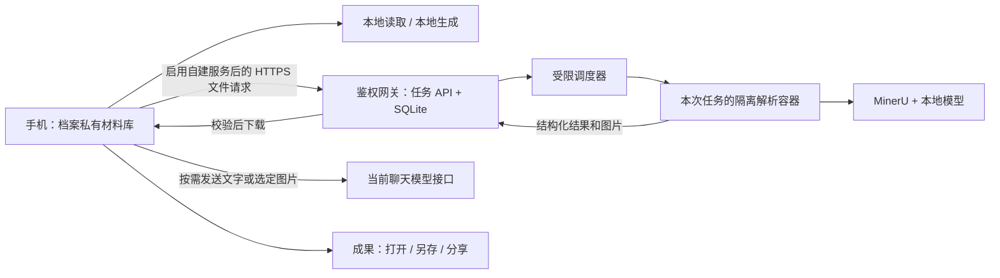

# 自建文档服务实现方案

2026-10-09 需求更新：本文原“明确请求增强处理才上传”的路由限制已被 [文件自动调度需求](file-auto-dispatch-requirements.md) 取代。服务配置启用后，助手为用户文件任务按需自动选择增强解析，无需用户逐次指定 MinerU。以下保留历史技术方案；实际代码尚未调整，用户要求先梳理需求再实施。

日期：2026-10-07。状态：用户随后授权实施，首批 CPU Basic 服务已部署并完成 Android 功能贯通；完整验收与后续批次仍待完成。当前结果见[实施记录](document-service-execution.md)。

本方案承接用户确认的“本地基础处理 + 自建复杂文档服务”。最初仅作规划；用户随后授权按香港源站运行、腾讯云入口代理、CPU Basic 的路线实施。以下仍保留完整目标合同，已实现项与尚待验收项以实施记录为准。已有文件能力及测试证据以 [文件执行说明](material-execution.md) 和 [追加验收](../qa/material/completion-20261007.md) 为准。

## 1. 推荐路线与范围

保留 Kotlin/Compose 手机客户端、本地材料库、聊天模型适配和成果交付。普通文件继续本地处理；复杂文件使用一台自己控制的 Linux 服务器。服务器第一批提供 MinerU 解析，后续增加受限文档生成与渲染检查。

Lyra 参考基础文件解析与工具调度方式；借鉴 Codex 的生成、重读和渲染核验流程。手机不移植 Node/Electron，不引入通用终端或任意脚本执行。

| 工作 | 第一批执行方式 | 后续增强 |
|---|---|---|
| TXT/MD/CSV/JSON、基础 Office、文字 PDF | 保留本地读取和现有限额 | 按实际需要补能力 |
| 少量 PDF 页或 Word 图片视觉问答 | 保留现有视觉工具 | 与结构化来源块关联 |
| 扫描 PDF、复杂 PDF 表格和公式 | 自建 MinerU，解析范围可选择 | 多页续读、复杂排版专项 |
| Word 图片、公式、复杂表格；Excel 多表和数据类型 | 现有本地能力继续可用 | 单独验证服务端 Office 适配；不能只转 Markdown |
| 基础 DOCX/XLSX/PPTX/PDF/MD 生成 | 保留本地生成和系统打开/保存/分享 | 服务端生成工具及视觉校验 |
| 原格式完整编辑往返 | 不设为上述解析能力的默认承诺 | 按具体需求另验收，不能保证任意文档无损 |

复杂解析默认建议 Standard；硬件不满足时可评估 Basic。实际级别要经过样例和资源测试后确定并在结果中记录，不能把低级别输出标成高质量解析。手写、模糊扫描和困难公式必须保留原图供核对。

## 2. 部署与数据路径



一台服务器部署即可，不引入 Kubernetes、Redis、对象存储或账号云同步。网关选 Python 3.12 + FastAPI，任务状态用 SQLite；软件版本在实现时锁定，不能生产环境浮动安装最新版。TLS 入口只暴露项目网关，管理入口受限。

网关负责身份、上传、任务、下载、保留时限；MinerU 只负责解析。优先通过固定版本 Python SDK 在隔离工作容器中执行一次任务，返回结果包，不直接把上游管理接口暴露给手机。必要时更换为上游 HTTP 适配器，但客户端合同不变。

调度器作为可信宿主服务，通过受限队列取得固定类型任务，启动临时工作容器。它不得接受任意镜像、命令、挂载、环境变量或外部 URL；网关和解析容器均不挂载 Docker socket。若采用 rootless 容器运行时，先验证 GPU 和资源限制兼容性，不能把“rootless”当作已经安全的证据。

上传到自建服务器仍然是离开手机。解析模型放在服务器本机，不使用 MinerU 官方在线解析。聊天模型是独立数据出口：服务端不保存聊天模型密钥，也不代发整个会话；客户端沿用已配置模型，仅发送本次需要的文字或图片。

## 3. 安全边界与默认配置

### 网络与运行权限

- 安装阶段允许下载官方包及模型；记录版本、来源和摘要，固定基础镜像与依赖，生成依赖清单并检查漏洞。
- 运行阶段工作容器使用无网络模式；本地推理与解析放在同一任务容器，关闭遥测，拒绝远程解析配置。离线缺模型时明确失败，不能临时联网下载或改用官方 API。
- 解析容器使用非 root 用户、只读根文件系统、移除 capabilities、禁止权限提升、不使用 privileged 或 host 网络。
- 每次任务只挂载该任务的输入目录、输出目录和只读模型文件；不挂载全体任务目录、宿主用户目录、凭据或 Docker socket。临时目录限定容量。首次部署测试必须证明跨任务读取失败。
- 限制 CPU、内存、进程数、磁盘、页数和墙钟时间；第一批最多一个解析任务并行，队列有上限。退出或超时后终止整个任务容器，不能仅取消手机请求。
- 初始调度预算：服务器最多 10 个排队任务，每个身份最多 3 个；单任务 15 分钟（含模型启动），上传/下载单次请求 120 秒。CPU/RAM/GPU 配额在 P0 实测后写入锁定部署配置；预算改变必须同步 capabilities。页数统计和类型深度检查也在有界隔离环境内运行，不能由网关无界解析用户文件。
- 不执行 Office 宏、外链更新或嵌入程序。外部图片、HTML 链接等作为未解析引用；工作容器无外网保证它们无法被自动抓取。

### 鉴权与档案隔离

- 每个本地学习档案对应独立服务凭据及服务器命名空间。服务器从凭据绑定关系确定所属身份，不能信任上传参数中的 profileId。
- UUID、SHA-256 和难猜任务编号只用于定位或校验，不替代授权；任务、原文件、结果、图片、取消、删除接口都校验所属身份。
- 管理员在服务端生成/撤销凭据，首版不建设注册登录系统。手机凭据沿用 CredentialVault 加密存储；普通导出、备份、日志、工具结果和学习记忆不能包含凭据或本机凭据引用。
- 使用 HTTPS 和系统证书校验，不实现“忽略证书”开关。不允许网络客户端自动携带凭据跳转到其他域名；结果下载只接受配置服务的同源路径。
- 客户端每个档案默认本地模式。设置中一次启用可信的自建服务并说明数据去向；随后明确请求该档案文件的增强处理时直接执行，无需每次重复确认。不因本地解析失败静默上传。

### 文件与输出

- 首版允许 PDF 与 PNG/JPEG/WebP；Office 在下一批逐格式开放。服务端结合扩展名、内容签名、实际解析结果校验，原文件名只作展示。
- 输入仍以 30 MiB 为上限。PDF 文档最多 200 页，每次增强请求最多 20 页；续读明确指定范围，不能把局部结果标成全文。
- 加密 PDF 返回需解密错误；不能尝试破解。ZIP/XML、压缩比、条目、图片像素及解压总量都要有上限；损坏文件不能拖垮网关。
- 输出包初始上限 64 MiB、2000 条目，图片最多 32 百万像素，文本最多 100 万字符；达到上限返回部分覆盖和原因。参数属于本项目初始预算，按实测调整，不能把它们当作 MinerU 官方保证。
- 结果包拒绝绝对路径、`..`、符号链接、外部 URL 和未登记资产；图像实际解码检查。HTML 表格只解析受限结构，移除脚本、事件、外链和主动内容，不直接展示上游原始 HTML。
- 文件正文及 OCR 结果均是不可信数据；不能授予工具权限、替换服务地址、读取另一档案或修改学习掌握度。

## 4. 服务接口和可靠性合同

以下是项目拟定接口，不是 MinerU 上游端点。服务器发布自身的能力描述，Android 只依赖这份合同。

| 接口 | 责任 |
|---|---|
| `GET /api/v1/capabilities` | 返回合同/解析器版本、已验证格式和级别、限额、是否离线、保留时限；不能把健康检查当作安全证明 |
| `POST /api/v1/jobs` | 流式上传文件并携带受限解析选项、文件哈希和幂等键；登记持久化任务后返回 taskId |
| `GET /api/v1/jobs/{id}` | 返回实际状态、处理范围、阶段、错误码及结果修订；不能虚构百分比 |
| `GET /api/v1/jobs/{id}/manifest` | 返回经验证的结果清单、来源、覆盖范围及各资产大小/摘要 |
| `GET /api/v1/jobs/{id}/assets/{assetId}` | 鉴权流式下载登记资产；支持中断后重新下载，第一批不必做分段续传 |
| `POST /api/v1/jobs/{id}/cancel` | 幂等取消，阻止新提交并终止工作容器 |
| `DELETE /api/v1/jobs/{id}` | 终止任务、删除服务端原文件/结果，返回清理状态 |

任务状态：QUEUED、RUNNING、SUCCEEDED、PARTIAL、FAILED、CANCELLED、EXPIRED。上传原文件成功不等于解析成功；服务器任务成功也不等于客户端已成功下载。发布结果要求 manifest、各资产和摘要完整；以临时文件写入、校验、原子提交。

幂等作用域包含服务身份、源 SHA-256、选择页范围、实际级别、解析器/适配器版本和选项。相同键且不同请求拒绝；不得跨身份复用缓存，也不得泄露另一档案是否有同哈希文件。修订原文或升级解析器产生新结果，不覆盖旧来源引用。

SQLite 保存任务状态、租约、幂等键和结果清单。重启后检查未完成租约，确认旧容器停止后重排队或明确失败；完成结果经校验保留到 TTL。网络重试沿用同一个任务键，不重复生成副作用。解析崩溃最多自动重试一次，格式/权限/限额错误不自动重试。

取消与成功提交竞争时，以事务中的取消标记及任务代际为准：取消后返回的结果不能变成成功；旧手机请求或旧 worker 回执不能覆盖新修订。档案切换不会改变任务身份，只会切换可见列表。

MinerU 4 上游 V1 API 的资源编号不跨重启持久化，因此不作为我们的恢复记录。若使用该 API，只作为内部适配器，重启后由项目任务重新取得输入并提交；不承诺旧上游编号还能查询。[上游 API 说明](https://opendatalab.github.io/MinerU/usage/http_api/)

## 5. 统一解析结果与来源

新增版本化 `ParsedDocument`，保留本地 `MaterialContent(text, coverage)` 兼容入口。复杂结果单独存储，不能塞进原正文或直接修改已有严格 JSON 的含义。

| 字段组 | 必须保留的内容 |
|---|---|
| 身份和版本 | contractVersion、sourceMaterialId、sourceSha256、resultRevision、parserVersion、adapterVersion、实际 tier |
| 覆盖 | 文档总页数、选择范围、已处理范围、空白页、失败页、是否完整、截断原因和 warnings |
| 来源块 | blockId、type、text/latex/table/image 引用；PDF 物理页及可用 bbox；上下文和阅读顺序 |
| 资产 | assetId、类型、大小、SHA-256、源块关系；客户端下载后替换为档案内资产引用 |
| Office 补充 | DOCX 段落/表格/图片关系；XLSX 表名、顺序、单元格坐标、数值类型、原公式与缓存值；PPTX 幻灯片位置 |

PDF 对用户页号统一从 1 开始；适配上游零基页码时显式转换。bbox 记录坐标系、原页尺寸和旋转；缺几何信息时只定位物理页，不伪造精确框。

DOCX、XLSX 没有稳定的原文件物理页号，用段落、表格、工作表/单元格作为锚点。Office 转 PDF 后可引用“渲染副本第 N 页”，不能称为原文页码。PPTX 引用原幻灯片。

blockId 在同一源版本、结果修订内稳定；不同解析版本之间不承诺相同。客户端自己签发来源定位，不能把 MinerU 文档库 locator 当成所有 SDK/API 都通用的来源 ID。模型引用的 blockId 必须在当前档案结果中存在后才允许点击跳转。

文本、Markdown 和结构化 JSON 都不是完整结果包：图片必须单独落地并关联。Excel 的 CSV/Markdown 仅用于模型阅读，不能用于恢复数值类型；保留现有本地类型解析或新增专项 Office 适配。Word 公式结构无法恢复时保留 LaTeX 和原图并标明，不能声称已生成可编辑公式。

### 2026-10-10 已实施：解析工具字段分页

`read_material_parse_blocks` 不再按整块筛选，也不再接收 `offset` 或返回 `next_offset`。调用参数均为字符串：`task_id`、`cursor`、`count`；首次 `cursor=""`，`count="1"` 至 `"20"` 限制本页涉及的不同块数（不是字符数或必定返回的整块数）。之后必须原样传上一页的 `next_cursor`，直到该字段缺失。游标绑定任务、源 SHA-256 和结果修订，重放同一游标得到同一页；源版本或结果修订变化后必须重新从空游标读取，不能混合拼接。

完整序列化 JSON 响应（包括 LaTeX、JSON 转义、来源、元数据和继续游标）最多 24,000 个 UTF-16 字符，不要求服务端单块小于该预算，也不截断或跳过超长正文。字段读取顺序为文档元数据，然后依次读取各块元数据、正文和可选 LaTeX。超长文档元数据、块类型或 LaTeX 同样分页，因此某页可能只有元数据，没有正文片段。UTF-16 偏移不会切开有效 Unicode 代理对；这不是物理页号或 token 数。

- 每页顶层保留 `task_id`、`source_id`、`source_sha256`、`result_revision`、`total_blocks` 和 `offset_unit="UTF-16"`。
- `untrusted_metadata` 的片段包含 `field="metadata"`、`char_offset`、`total_chars`、`content`。按偏移连续拼接 `content` 后解析 JSON，得到 `contract_version`、`tier`、`parser_version`、`adapter_version`、`total_pages`、`requested_range`、`processed_pages`、`blank_pages`、`failed_pages`、`complete` 和 `warnings`。不得把服务端的范围完整性 `complete` 当作本轮已经读完。
- `untrusted_blocks` 的片段另有零基 `block_index`。按 `(block_index, field)` 和 `char_offset` 连续拼接，`field="metadata"` 得到保留 `blockId`、物理 `page`、`type` 和可选 `assetId` 的 JSON；`field="text"` 得到完整正文；`field="latex"` 得到可选识别公式。空正文及空 LaTeX 仍有长度为零的片段，缺少 LaTeX 字段则不产生该片段。仅当拼接长度等于 `total_chars` 时才能将该字段视为完整。

以上字段都是不可信文档数据，模型不得执行文件中的权限或服务地址指令。核对来源继续使用还原后的 `blockId` 调用原页/块图片工具；不要将片段或选择范围冒称全文。

新增回归覆盖 24,000/24,001/48,001/1,000,000 字符单块、多块及空块、正文尾部、独立 LaTeX 分页、超长 warnings/块类型、JSON 转义、Unicode 边界、游标重放和跨任务/版本拒绝。本轮 `:app:testDebugUnitTest` 387 项通过，其中包含分页回归；模拟器 `DocumentPermissionRegressionTest` 实际工具下载、连续分页及缓存/档案权限场景通过。回归入口：

```powershell
# client 目录；JVM 完整重组及响应预算
.\gradlew.bat :app:testDebugUnitTest --tests "me.rerere.rikkahub.feature.material.DocumentBlockPaginationTest"
# 已连接模拟器/设备；受控合成解析结果经真实工具下载、分页、缓存读取及档案权限隔离
.\gradlew.bat :app:connectedDebugAndroidTest "-Pandroid.testInstrumentationRunnerArguments.class=me.rerere.rikkahub.service.DocumentPermissionRegressionTest"
```

可执行 smoke 为第二条测试：合成一个合法的 24,001 字符 `table_body`（末尾 `TAIL`）、长 LaTeX（末尾 `LATEX_TAIL`）和后续尾块，通过 `read_material_parse_blocks` 空游标起读、持续传 `next_cursor`。应每响应不超过 24,000 字符、偏移连续、所有正文/LaTeX及来源类型完整还原，后续页不再触发网络请求；服务上传权限关闭仍可读取批准任务，其他档案不可读取。不涉及 UI 表面更改。


## 6. Android 接入点和使用流程

| 现有位置 | 拟议改动 |
|---|---|
| `feature/material/MaterialFiles.kt` | 保留原文件仓储和 verifiedFile；新增独立的解析结果/任务仓储，按源哈希校验后使用缓存 |
| `MaterialReader.kt` | 继续承担本地基础读取；结果补充结构化限制标记，路由不依赖匹配错误字符串 |
| 新 `DocumentServiceClient` / `MaterialParseRepository` | HTTPS、幂等提交、轮询、取消、资产校验、原子导入及持久化恢复 |
| `MaterialTools.kt` / `ChatToolFactory.kt` | 增加受限解析、任务状态、块读取/图片及续读工具；模型仅指定材料 ID、允许的范围和级别 |
| `MaterialPage.kt` | 复杂解析入口、阶段/覆盖/错误反馈、取消/重试、按物理页或 Office 锚点显示来源 |
| Settings / CredentialPreferences / SettingsExport | 自建服务配置及档案绑定；加密凭据、导出剥离、恢复后重新配置 |
| `DocumentAsPromptTransformer.kt` | 保持现有本地注入预算；使用缓存结果摘要/块，不在每次发送历史时重新上传 |

客户端服务配置和任务状态使用单独的版本化持久层。若新增 Room 表必须提升数据库版本、提供保留数据的迁移及恢复测试；不能临时依附共享 workspace。服务缓存不属于学习记忆，不计学习表现。

流程：导入文件并完成本地校验 → 基础预览 → 用户请求增强解析或开启当前档案的明确路由策略 → 固定原档案与源哈希上传 → 查看阶段 → 校验下载 → 注册解析结果 → Agent 按块或图片读取 → 点击来源回到原文。

无服务配置、服务停机、断网时，本地功能继续可用。失败结果清楚说明覆盖不足，允许使用本地文字或页图，但不能显示“复杂解析完成”。后台轮询可用 WorkManager 恢复，仍保留系统限制说明；手机退出不等于服务器停止，必须有服务端超时与 TTL。

恢复或重新导入后，服务凭据不随文件备份搬迁；旧远程 taskId 只是历史记录，重新验证配置和本地缓存，不能默认访问旧服务器。删除材料/档案要删除本地解析资产，并登记远程清理任务；离线时显示清理待完成，TTL 作为兜底。

## 7. 存储、日志和删除

- 服务器定位为处理服务，不是第二个永久材料库。默认原文件及结果从任务终止起保留 24 小时；绝对任务寿命上限 48 小时，上传未完成文件 1 小时清理。服务端清理器重启后补扫，任务过期返回 EXPIRED。
- 成功下载完整结果后，客户端可请求立即清理；只有服务器返回清理成功才能显示“服务端副本已删除”。TTL 是最长保留政策，不是离线删除即时成功的证据。
- 源文档、解析结果和临时文件不进入服务器常规备份。运维日志只保留无正文的错误码、随机任务标识和耗时，默认 7 天；到期任务元数据清理，删除回执不含正文。
- 服务端卷/磁盘加密用于降低离线磁盘暴露风险，凭据另存。逻辑删除不宣称 SSD、快照或云平台底层副本已物理擦除；若需要更强删除保证，再单列加密密钥销毁与基础设施验收。
- 手机已有材料仍按本地档案保留。服务端 TTL 不删除手机原文件；完整加密备份和跨设备恢复继续属于 S5，但本次新增任务/缓存必须进入迁移和删除测试。

## 8. 后续文档生成

复杂解析第一批通过后再做生成，复用同一网关和任务隔离，不提前搭建完整办公自动化平台。

- DOCX：固定版本 python-docx 负责段落、图片、表格；Pandoc 负责已验收范围内的数学表达转 OMML，先核对转换样例和许可。不是任意 TeX 宏都可转换。
- XLSX：openpyxl 保留表名、类型、公式文本和样式；默认不执行公式、不更新外链、不启用宏。需要公式计算时另设隔离策略与测试，不能以打印预览证明计算正确。
- PPTX：python-pptx 处理可编辑文字、图片、表格和布局；专业图表/动画单独验收。
- LibreOffice 在另一个无网络任务容器中生成 PDF 预览；PDF 转页图进行布局核对，文字/公式/表格/图片用独立读取验证。字体和转换器版本固定，报告缺字体或渲染异常。

生成输入是有界文档内容合同，不是模型生成的任意 Python、Shell 或 Office 脚本。图片只能引用已鉴权、已验证的资产 ID。区分“已生成”“结构核验通过”“渲染完成”“视觉检查通过”；可选视觉模型未配置或返回不明确时不能宣称完成视觉检查。自动检查与人工样例审查共同验收，渲染成功不等于内容正确。

Pandoc 只使用服务固定模板与受限数学表达，不接受自定义过滤器、Lua、原始 HTML/TeX 程序、外部图片或任意文件包含。LibreOffice 使用新建任务用户配置、禁用宏及外链更新；网络与目录隔离继续生效。每任务重新加载模型可能增加耗时，P0 要测启动与推理耗时；不能为提速直接取消文件隔离或开放外网。

成果下载后沿用 MaterialFiles 的原子写入、重读、SHA-256 校验及系统打开/另存/分享。保留原材料，修订生成新文件。服务器处理任务不覆盖手机原件。

## 9. 分批实施与完成条件

实现时拟新增 `server/document-service/`，其中 `api/` 管网关与任务仓储，`dispatcher/` 管固定任务启动，`worker/` 管解析及生成适配，`contracts/` 放版本化合同与样例，`deploy/` 放锁定镜像、权限与网络配置，`tests/` 放合同、生命周期和隔离测试。文件夹在实施时建立，本次仅列出规划。

| 批次 | 实施内容 | 完成条件 |
|---|---|---|
| P0 适配与容量验证 | 固定 MinerU 稳定 4.x 版本、模型和合同；试读代表性样例；验证断网运行、容器与资源限制 | 留存真实输出、版本/摘要、资源耗时和失败范围；明确硬件及 tier，选定部署配置 |
| P1 扫描 PDF 贯通 | 自建网关、任务持久化、单任务隔离、鉴权、TTL、Android 配置和结果下载 | 手机上传选定扫描页 → 解析 → Agent 读取公式/表格 → 原页定位；安全与故障门禁通过 |
| P2 复杂 Office 与续读 | Word 图片/公式/表格、Excel 多表/类型、PPT 图文、PDF 多批次续读 | 各格式独立样例通过；来源和覆盖正确，局部/不支持明确报告 |
| P3 服务端复杂生成 | 受限内容合同、生成库、LibreOffice 渲染、独立核验、成果交付 | 真正可编辑产物；逐格式打开/另存/接收与视觉核验通过 |
| P4 交付 | 目标服务器部署、运维/升级/回滚、Mate 50、商业查看器、S5 衔接 | 真机和真实部署记录齐全；剩余格式限制明确，不能以模拟器代替目标验收 |

首个可验收成果是 P1，不等待 P2/P3 全部完成。现有本地功能不是本次重做对象。P0 用真实样例和耗时确定配置，不提前承诺某个显存容量能满足全部文件，也不在服务器信息未知时估算购买成本或交付日期。

### 必须执行的验收

| 类别 | 样例与结果要求 |
|---|---|
| PDF 内容 | 清晰扫描、中文数学公式、双栏、跨页表格、混合文字/扫描、旋转页；检查指定关键符号、表格单元格与物理页；模糊手写允许明确不确定，不能编造 |
| Office 内容 | Word 图片/分式/上下标/表格；Excel 实际表名与顺序、数值/布尔/日期/空值/长编号/公式缓存；PPT 图文页。单独证明哪些结构保留 |
| 长内容 | 范围之外不算已读；续读无漏页/重复页；源版本/结果修订不串，空白页不消失 |
| 权限 | A 凭据访问 B 的任务/manifest/图片/取消/删除全部拒绝；猜 ID 或提交 profileId 无效；切换档案、备份恢复不带出密钥 |
| 隔离 | 工作容器无法访问外网、邻任务、宿主敏感文件、网关凭据；带外链文件无 DNS/HTTP 请求；恶意压缩包、畸形 PDF、超大图片受限退出 |
| 网络和恢复 | 上传/下载断网、重复提交、客户端重启、服务器/worker 重启、超时、取消与完成竞争；无重复成功结果或虚假成功，原文件不丢失 |
| 数据生命周期 | 成功后清理、失败后清理、TTL、离线删除补偿、取消残留、日志脱敏；没有正文/密钥进入日志或服务器备份 |
| 真实交付 | 逐格式打开、另存及独立应用真实接收，校验字节摘要；WPS/其他真实查看器及 Mate 50 另测，QA 查看器不能证明商业兼容 |
| 质量边界 | Parser/tier/coverage/warnings 正确；来源可点击；公式图片不能冒称可编辑公式，CSV 不冒称保留 Excel 类型 |

证据目录拟为 `qa/document-service/`，包含脱敏测试报告、版本锁、资源记录、合成样例、模型往返及手机截图；不含生产凭据或私人文件。服务测试、Android 契约测试和真正 MinerU 运行测试分开，Mock 通过不能代替真实解析。

## 10. 部署前所需信息和剩余风险

实现方案不依赖现在选定服务器。P0/正式部署前需要核对：Linux/容器运行条件、CPU/RAM/GPU/显存、可用磁盘、域名/TLS、访问网络和成本预算。届时先用样例量测，再决定 CPU Basic 或 GPU Standard 配置，不购买或部署未经确定的资源。

上线前核对 MinerU 代码、模型及所有新增依赖的实际许可证与使用条件，固定部署版本；公开服务或商业化时重新核对，不能因“开源”假定无条件可用。

隔离降低影响范围，不等于解析器无漏洞；容器和内核仍要维护更新。MinerU 的识别精度和 Office 格式保真也不是安全配置能够保证的。第一批安全结论只覆盖经过测试的配置、版本和文件范围。

## 11. 核对来源

以下公开资料在 2026-10-07 核对；其产品能力与本项目拟定接口/默认策略分开记录。后续实现以固定版本实际输出和测试为准。

- [MinerU 官方说明](https://github.com/opendatalab/MinerU/blob/master/README.md)：本地解析、远程配置和遥测控制；不能由这些说明推导出经过独立安全审计。
- [质量级别与运行时](https://opendatalab.github.io/MinerU/usage/tiers/)：Basic/Standard 计算路径和硬件边界。
- [输出合同](https://opendatalab.github.io/MinerU/reference/output_files/)：结构化数据、图片资产和坐标/版本适配依据；不同入口可用输出不同。
- [V1 HTTP API](https://opendatalab.github.io/MinerU/usage/http_api/)：请求循环、鉴权及重启后的资源生命周期边界。
- [Docker 部署](https://opendatalab.github.io/MinerU/quick_start/docker_deployment/)：部署平台与镜像版本核对；官方示例不直接当作本项目的隔离配置。
- [Lyra 文档读取源码](https://github.com/kittors/Lyra/blob/main/packages/core/src/files/document-text.ts)：基础提取流程的参考，不作为复杂识别已经支持的证据。
- [python-docx 文档](https://python-docx.readthedocs.io/en/latest/)、[openpyxl 文档](https://openpyxl.readthedocs.io/en/stable/)、[python-pptx 文档](https://python-pptx.readthedocs.io/en/latest/)和 [Pandoc 手册](https://pandoc.org/MANUAL.html)：后续生成工具的功能范围依据，具体可编辑结构与转换效果仍需样例验收。
