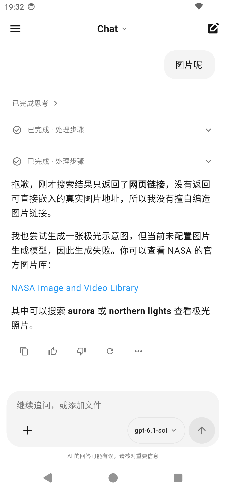
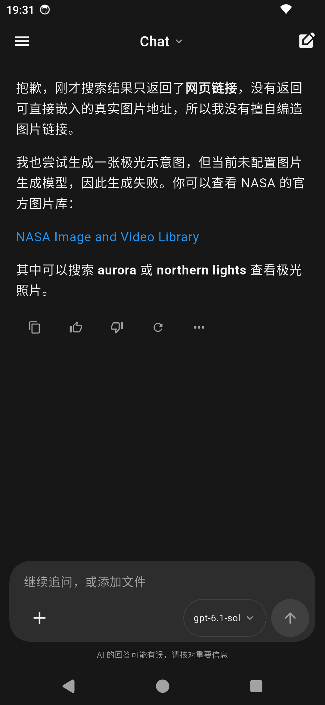
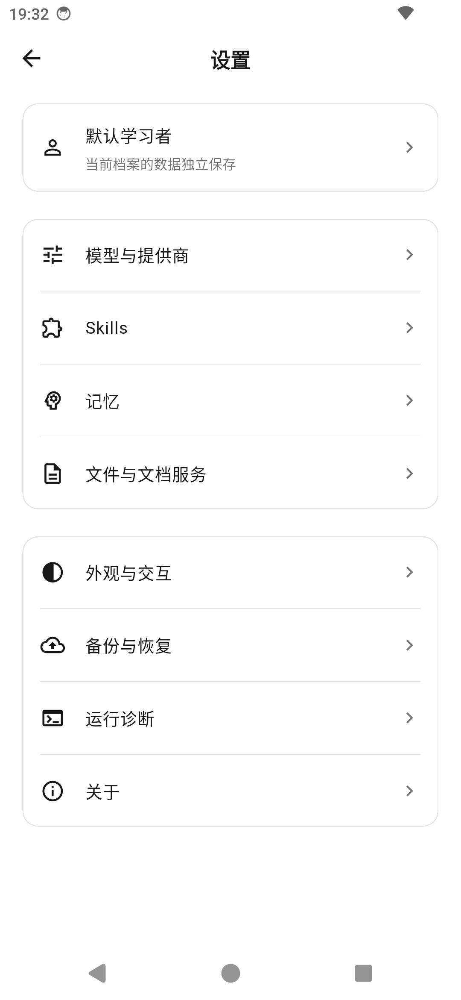
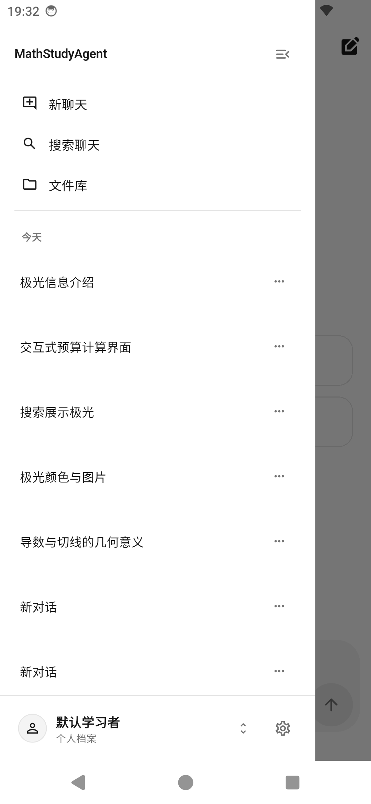

# 前端黑白灰样式交付 · 2026-10-10

## 参考与实现

采用桌面 `MathStudyAgent_Gemini_前端实现全页面交接.pdf`（52 页，P01–P45）；聊天基础构图以 `docs/ui-design/chatgpt-inspired-v1/two-page-preview.png` 为准。截断的参考图按照同一套排版、颜色、圆角和现有真实数据接口适配。

主背景 #FFFFFF，文字 #171717 / #737373，用户气泡与输入区 #F4F4F4，边框 #E5E5E5。深色背景 #171717，表面 #202020，气泡 #2D2D2D。统一标题、细边框分组、按钮、搜索、表单、弹层、空态与错误态；启动窗口也采用中性配色。

## 页面覆盖与适配

| 参考 | 入口 / 组件 | 实现与边界 |
|---|---|---|
| P01–P03 历史、搜索、更多 | Chat 抽屉、搜索、聊天菜单 | 真实历史、搜索、重命名、删除；置顶/归档沿用本次运行内的客户端状态，未新增后端持久化；分享未接入时禁用 |
| P04–P06 模型、附件、回答 | Chat、ModelPicker、ChatComposer | 搜索真实模型；附件菜单与原文件选择桥接；自然文本与灰色用户气泡 |
| P07–P09 图文、图片查看、来源 | MathMarkdown、EnhancedImageView、CitationsSheet | 保留原智能消息组件，图片缩放与真实 URL；无引用时显示空态；图片页支持带上下文追问 |
| P10–P12 图表、表格、参数 | InteractiveSurface 的全屏视图 | 使用实际工具输出与已保存参数，统一追问框；独立路由无数据时给出返回聊天的说明 |
| P13–P15 附件、发送、失败 | 附件弹层与消息状态 | 档案/上下文校验、真实发送、失败保留草稿；没有语音录制伪入口 |
| P16–P17 成果预览、版本 | `/artifacts/preview`、`/artifacts/versions` | 实际成果状态、打开/另存/追问；版本关联接口尚未提供，仅显示当前真实成果 |
| P18–P21 文件、核对、成果列表 | `/files`、详情、符号核对、`/artifacts` | 真实文件元数据、筛选、添加、打开、核对提交；内嵌原页预览尚未提供，通过系统查看器打开原件 |
| P22–P26 设置、提供商、模型 | `/settings`、providers、models | 分组设置；现有提供商名称/启用和连接测试直接调用桥接；密钥、添加提供商、模型增删与参数配置进入现有原生管理工具 |
| P27–P29 Skills | skills、detail、import | 真实技能状态与依赖；启停调用现有接口，导入/卸载进入原生管理工具 |
| P30–P32 记忆 | memories、detail、edit | 真实内容、来源与版本，编辑与删除调用现有接口 |
| P33 个人档案 | ProfilePickerSheet | 真实档案切换与现有数据隔离；未增加档案 CRUD 后端接口 |
| P34–P36 文档服务 | doc-service、doc-tasks、task-detail | 配置、测试、任务列表与操作均连接现有文档仓库；凭据不回传前端，任务归属与上下文检查 |
| P37–P38 备份与恢复 | backup、restore | 统一样式入口，实际导出/导入及确认沿用原生安全备份工具 |
| P39 诊断 | diagnostics | 原有诊断与导出，文档服务状态读取实际配置 |
| P40、P43–P44 外观、深色、大字体 | appearance 与全局主题 | 明暗主题、跟随系统字体、放大 25%、减少动态、自动跟随；偏好写入 Android SharedPreferences 并在启动恢复 |
| P41–P42 空态、删除 | 各数据页与记忆删除弹层 | 无演示条目和伪成功反馈；真实数据空态与确认 |
| P45 语音 | 条件功能 | 当前 Flutter 录音桥接未提供，保持不可用说明，不显示假录制动画 |

## 验证

- Flutter 测试 164 项全部通过，包括原有回归，以及 31 个页面/弹层分别在浅色手机、深色 320px 窄屏且字体 1.3 倍的布局检查。
- `flutter analyze --no-fatal-infos`：0 error、0 warning；保留 82 条 info（主要为 const、流程大括号和旧 API 提示）。
- Flutter debug AAR 构建成功，Android `:app:assembleDebug` 构建成功。
- 最终 debug APK 已覆盖安装至 emulator-5554，没有清除应用数据。实际检查聊天、抽屉、文件库、设置与深色切换，截图与日志存于同名子目录。
- 外部服务的实际网络解析、模型推理、备份恢复未在本次样式验收中触发。涉及原生管理工具的流程沿用已有实现，不能视为 Flutter 页面内全部能力已经新增。

## 产物与恢复

APK：`client/app/build/outputs/apk/debug/app-x86_64-debug.apk`；设备包名 `org.hxsi.agent.debug`。

修改前 Flutter 源码备份：`.local/frontend-neutral-baseline-20261010.zip`；哈希清单 `.local/frontend-neutral-baseline-20261010.json`。原生桥接与清单原件也已保存在 `.local/*-neutral-baseline.*`。该备份为本次样式工作开始时的状态，并不覆盖仓库其他已有改动。

修改清单：`neutral-ui-20261010/changed-files.json`；另涉及原生 `StudyFlutterActivity.kt`、`StudyHostFacade.kt`、AndroidManifest 与三份中性启动主题资源。

