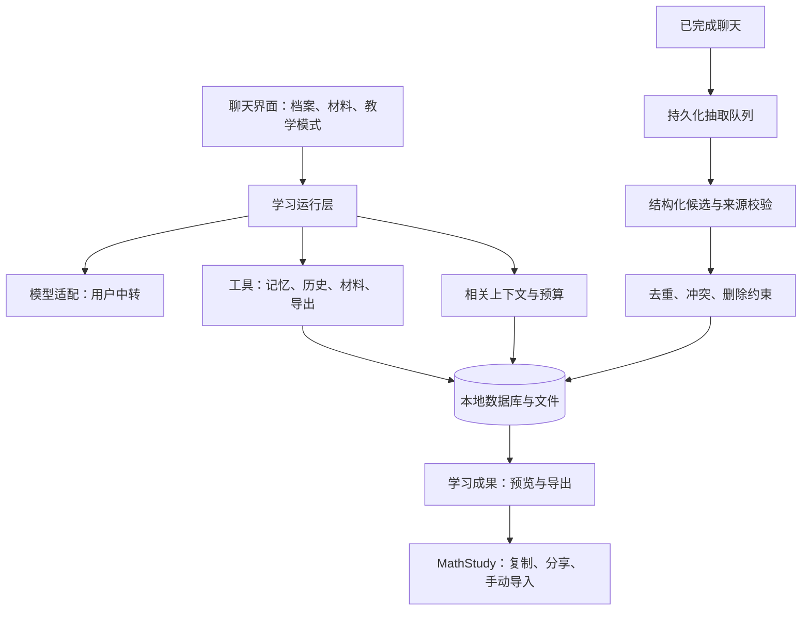

# MathStudyAgent 详细实现方案

版本：草案 v0.2，2026-10-02。状态：**S0 执行中；固定上游已获取，数据合同与本地探针已建立；Android 业务实现尚未开始，真机与中转验证待完成**。当前进展以 [S0 执行记录](s0-execution.md) 为准。

证据见 [项目上下文](project-context.md)，测试入口见 [验收矩阵](acceptance-matrix.md)。本文的架构、批次和参数是实施建议；用户已确认的范围以 README 和最新表达为准。

## 1. 产品目标与首版定义

做一个在华为 Mate 50 上独立运行、面向一至两名数学师范学习者的教学 Agent。手机管理聊天、个人记忆、Skills 和材料，直接连接使用者配置的模型中转。学习者可以拍题、追问、提交自己的推导、阅读讲义，并把学习成果导出为真实文档。

首版必须完成下面这条闭环：

> 上传一道题或一段讲义 → 选择引导或完整讲解 → 连续问答 → 自动保存有证据的学习记忆 → 新会话找回相关困难 → 生成并分享学习笔记。

| 能力 | 完整 v1 的交付范围 | 首版边界 |
|---|---|---|
| 教学聊天 | 自配接口、流式、多会话、公式、提示/引导/检查/完整讲解、取消及失败重试 | 数学正确性按证据表达；不做训练或权重微调 |
| 自动记忆 | 明确记住、增量抽取、去重、冲突、跨会话检索、来源、编辑、删除、防历史再抽取 | 不建立正式掌握度评分或独立复习日历 |
| 材料问答 | 图片、文本 PDF、扫描 PDF 指定页、DOCX、TXT/Markdown；能回到来源 | 旧 DOC 提示转换；PPTX 作为已存在能力的兼容检查，不扩展为重点 |
| 文档生成 | Markdown 与 PDF；推荐先完成 PDF，再完善 DOCX | 是否首版必须同时交付 Word 待用户回答；可编辑公式另立验收 |
| Skills | GitHub/本地包导入、按需加载、来源与版本、依赖检查、三个内置教学技能 | 不执行任意技能脚本；自动生成技能后置且先为草稿 |
| 本地可靠性 | 使用者档案隔离、任务持久化、加密备份、恢复、升级保全 | 不承诺锁屏一直运行，不建设账号云同步 |
| MathStudy 配合 | 复制、分享、文件导出；成果带来源和“候选”属性 | API 双向同步后置；不会自动改计划、错题或掌握度 |

第一份内部演示可以只覆盖“聊天 + 自动记忆”，但不能以演示版代替包含材料和文档闭环的完整 v1。视频、地区考试配置、试讲专项、复杂工程工具和多 Agent 放在后续需求评估。

## 2. 技术路线与实施前置验证

### 2.1 主路线

用户于 2026-10-02 提供的截图确认设备为 **HUAWEI Mate 50（CET-AL00），HarmonyOS 4.2.0**。华为官方支持文档列有 HarmonyOS 4.2 的外部来源应用安装路径，因此当前主路线选用 **Android APK**；RikkaHub 在这台手机上的实际安装和运行仍须通过 S0 验证。[华为外部来源安装说明](https://consumer.huawei.com/cn/support/content/zh-cn00766399/)、[HarmonyOS 4.2 安装包安装说明](https://consumer.huawei.com/cn/support/content/zh-cn01089223/)

以 RikkaHub 2.5.6、提交 `447bb7e89710d31f1204d7a2973baa19fdbd5b28` 为主底座，沿用 Kotlin、Compose、Room 和现有模型适配层。Lyra、Hermes、oh-my-pi 只贡献记忆设计与经核对的局部实现。

现有生成链路包含 `ChatService`、`GenerationHandler`、输入变换器及工具接口；新增能力通过这些边界接入，减少重写聊天系统。固定版本的 `memory_tool` 与 `use_skill` 已核对，详见上下文中的源码链接。

### 2.2 真机验证与备用分支

系统资料已确认；截图未显示完整补丁/构建号，在安装验收时补记即可，不阻塞当前路线规划。下表的原生鸿蒙与特殊兼容环境是系统改变或实测异常时的备用分支，当前不启动对应开发。

| 验证结果 | 执行路线 |
|---|---|
| APK 可安装，RikkaHub 启动、网络、文件和公式正常 | 继续 Android 主路线 |
| APK 可安装，但部分功能依赖不可用 | 先定位 GMS/WebView/网络/文件依赖；基础闭环可修复时保留主路线 |
| 只能通过特殊兼容环境运行 | 单列兼容环境的文件、网络与升级限制；不默认作为正式交付路径 |
| 无法运行普通 APK，需要原生鸿蒙 | Android 主路线暂停；另拟 ArkTS/ArkUI + 鸿蒙存储、网络和文件接口方案，重新估算成本 |

系统兼容外部安装包不等于具体客户端已通过验收；仍检查启动、网络、文件、公式和后台恢复。如果后续系统升级改变运行环境，重新验证设备分支。原生鸿蒙分支可以复用数据合同、记忆算法和教学 Skills，但不能承诺直接复用 Compose UI、Android 原生库和 Room。

### 2.3 中转能力矩阵

以使用者实际 endpoint、模型、请求头和协议为单位保存能力结果，状态为 UNKNOWN / PASS / FAIL / NOT_SUPPORTED；换模型或接口后允许重新验证。不要把 ChatGPT 网页功能或 MathStudy 已接通的接口当作本手机接口的能力证明。

| 探针 | 合格证据 | 不支持时的处理 |
|---|---|---|
| 文本与流式 | 短文本、长文本 SSE、正常结束、取消、超时和错误返回 | 流式不可用时可用非流式降级，但标明差异 |
| 工具调用 | 小工具的请求 → 参数 → 结果 → 后续回答，完整往返 | 开放兼容聊天版；完整 Agent 验收不通过；不执行正文中伪造的调用文本 |
| 图片 | 清晰公式题图、中文手写图、错误关键符号的核对 | 文字题可用；图片能力关闭或另配已验证的 OCR 服务 |
| PDF/文件 | 已确认的上传格式、文件 ID 生命周期及引用方式 | 优先本地提取文本、指定页图片，不阻塞基本材料问答 |
| 结构化输出 | 合法 JSON、错误 JSON、空候选与截断输出 | 不依赖专用 JSON 模式；普通文本输出经本地 Schema 校验，失败不写记忆 |
| 上下文和资源上限 | 请求大小、合理上下文预算、429/限额、响应 usage | 本地预算可配置；没有 usage 时显示估算，不给出虚构费用 |

验证从无真实个人数据的小样开始，真实调用由实施范围和安全配置决定。立项规划轮没有读取 API 密钥或调用模型；已授权的 S0 使用用户为本项目配置的临时凭据执行探针，不继承 MathStudy 密钥。首次配置只要求必要信息；不要让普通学习者面对协议调试字段。

### 2.4 上游获取与工程组织

S0 已采用“本项目单仓库 + 固定上游快照”：保留根目录规划，RikkaHub 固定基线置于 `client/`，来源记录在 [upstream-lock.json](upstream-lock.json)。未创建 GitHub 远端，不额外 Fork 三套记忆框架。

如果用户需要 GitHub 原生 Fork，使用同一固定基线建立主 Fork，再按该仓库组织规划文档。两种获取方式二选一，不同时维护两份客户端。真正获取代码前核对现有文件并保全规划。

首版保留底座内部包名，采用独立 applicationId、应用名、版本号和签名，使应用可与 RikkaHub 并存。签名材料不入库。升级需要同一签名，不能把重新安装当作数据迁移。

固定版本构建有 Google Services/Firebase 插件和 SDK 37.2 要求；在实施前核验本机 Android 工具链。建议做学习用途的构建配置：聊天及文档能力不依赖 GMS，关闭非必要遥测与上游自动更新入口；先证明基础构建再做精简，不一开始重构全部 Gradle 模块。

## 3. 模块结构与接入位置

建议先在应用内设清晰包边界；只有职责稳定后才拆 Gradle 模块。

```text
client/                      固定基线客户端，实施阶段创建
  app/...
    feature/studychat/        教学模式、学习助手界面
    feature/learner/          学习者档案与所属上下文
    feature/memory/           记忆 UI、抽取、检索和合并
    feature/material/         材料、分块、页码与原图回看
    feature/artifact/         学习成果、PDF/DOCX 导出
    feature/skills/           上游 Skills 的适配与能力检查
    data/study/               Room 表、迁移和统一仓储
    runtime/study/            任务队列、上下文拼装、工具注册
docs/                        本项目方案与实施证据
qa/                          后续创建小型验收材料与结果
```

以上是拟议路径，不是已存在的源码目录。新增的关键接口为 `LearnerContext`、`MemoryRepository`、`MemoryExtractor`、`MemoryRetriever`、`MaterialRepository`、`ArtifactExporter`、`StudyJobRunner` 和 `ProviderCapabilities`。

| 接入点 | 新增行为 |
|---|---|
| ChatService 消息持久化 | 每轮固定 profile、conversation、branch 和消息版本；答复完成后登记待抽取范围 |
| GenerationHandler 生成前 | 拼装教学模式、已选 Skills、相关记忆和材料引用；控制总预算 |
| 输入变换链 | 新的材料分块与缓存路径替代学习会话内的全量文档拼接，避免同时执行两套解析 |
| 工具注册 | 仅注册该使用者可用的记忆、历史、材料、成果工具；校验能力条件 |
| Room 与文件仓储 | 所有读写先核验所属使用者，模型参数不能决定访问身份 |
| 导出/备份入口 | 固定成果版本、原子写入、完整性校验、系统分享或用户选择保存位置 |



## 4. 聊天和教学行为

主要界面保留聊天入口；旁边提供“记忆、材料、学习成果、设置”。Skills 是设置中的次级入口并可在聊天选择；不建设复杂工作台。

第一次使用：创建简单档案 → 填写模型接口 → 测试连接 → 开始聊天。档案只必填昵称，不强迫填写地区、考试或掌握度。手机只给一人使用时隐藏切换噪声；同机两人时显示当前档案，默认新会话继承当前档案。

| 模式 | 行为 |
|---|---|
| 引导学习，默认 | 判断已做的步骤，每轮推进一个卡点；必要时回到定义或反例 |
| 给我提示 | 控制提示程度，不主动泄露整题结果 |
| 检查步骤 | 找第一处实质错误或逻辑缺口，说明位置并给一个补全问题 |
| 完整讲解 | 用户明确选择或在聊天明确要求时，给完整解释与适用条件 |

正常语言指令优先于模式按钮，例如“这次直接完整讲解”。大学数学与中学数学的教学层级由当次任务和使用者说明决定，不从 MathStudy 高中轨道带入“禁止大学方法”。

关键行为：识别不清的正负号、指数、根号、不等号和区间必须核对；检查第一处缺口，不把后续文字完整当作证明正确；生成类似题时将题目与参考解答分开。没有验证工具时，用“根据推导”“这里尚未核验”等准确表述，不能标记“工具已验证”。

运行状态：IDLE → PREPARING → GENERATING → TOOL_RUNNING / WAITING_USER → GENERATING → COMPLETED；异常进入 FAILED / INTERRUPTED / CANCELLED。过程显示学习者能理解的短状态；不把工具 Schema、数据库字段或长调试日志放进主界面。

完成、取消和中断分别落盘。重启后保留用户输入、已接收文本、工具状态与附件；SSE 中断不保证在同一字符继续生成，提供重新生成或继续追问。产生文件等副作用工具使用幂等键，恢复时先检查结果，避免重复产物。

## 5. 自动长期学习记忆

### 5.1 记什么

| 类别 | 示例 | 保存规则 |
|---|---|---|
| 背景与偏好 | 正在学高等代数；喜欢先看反例 | 以使用者陈述或明确确认作依据 |
| 近期进度 | 正在讨论特征值、上次停在第二步 | 记录主题、时间和来源；过期后不当作当前任务 |
| 困难与错因 | 这次漏查定义域；两次混淆充分与必要条件 | 单次错误记录为单次观察，重复困难需多份独立证据 |
| 学习表现 | 一次提示后完成；看过解释，未完成练习 | 严格区分证据，不等同正式掌握 |
| 待复习建议 | 建议再练区间端点检查 | 本地建议，待用户选入 MathStudy |

“根因可能是……”保持假设状态；模型答案、教材作者观点和假设题设不能自动变成学习者事实。聊天引用片段与材料中的嵌套指令不能取得写记忆或改设置权限；使用者当前明确提出的“记住此事”走专门的保存路径。

### 5.2 数据合同

复用上游会话与附件存储，新增最少的学习表；S0 字段及事务约束见 [数据合同 v1](data-contract-v1.md)，Room 实现在后续阶段完成。

| 实体 | 关键字段与约束 |
|---|---|
| LearnerProfile | profile_id、昵称、语言/时区、记忆开关；与 Assistant 身份分离 |
| ConversationOwner | conversation_id → profile_id；分支和消息版本归属可追踪 |
| MemoryItem | id、profile_id、type、topic_key、content、origin、status、created_at、updated_at、last_evidence_at、revision |
| MemoryEvidence | memory_id、conversation/branch/message_id、message_revision、原文位置/摘要、material_anchor、evidence_type、validation_basis |
| MemoryRevision | 修订与来源变更；自动内容可留历史，彻底删除时清除有关正文 |
| MemorySuppression | 所属档案、来源范围、主题/事实键的最小指纹、delete_epoch；不保存已删除正文 |
| ExtractionCursor / Job | 已处理消息范围、来源哈希、提示词版本、状态、尝试次数、租约和预算 |
| MemorySummary | profile_id、摘要版本、对应的有效条目版本集合；可从有效记忆重建 |

origin 区分 USER_EXPLICIT、USER_EDITED、AUTO_EXTRACTED；status 区分 ACTIVE、CANDIDATE、SUPERSEDED、DISPUTED。低证据推断保持 CANDIDATE，不默认注入为事实。

学习表现建议编码：SELF_REPORTED、READ_ONLY、AFTER_EXPLANATION、WITH_HINT、INDEPENDENT_ATTEMPT、UNVERIFIED。即使观察到独立作答，也需保存正确性判断的依据；没有外部校验的表现不能被包装成受控认证。不给所有编码计算一个掌握分数。

### 5.3 明确记住与自动抽取

明确保存：UI 的“记住此事”或经已验证工具调用识别的用户指令 → 保存真实条目 → 反馈成功。工具未调用或写入失败时不能只回复“记住了”。没有工具调用能力时仍提供 UI 明确保存。

自动抽取默认面向新增的已完成聊天；在首次启用说明会调用所配置模型、记忆留在手机，设置可关闭。开启后普通记忆自动处理，不逐条索要批准；写入和撤销都可见。

初始触发建议：每累计 4 个完成的问答轮次，或使用者结束学习、点击整理、前台闲置后有未处理内容，登记一次增量任务；合并 60 秒内同一会话的任务。阈值是待实测参数；短会话也可在明确结束时抽取，不照搬 Lyra 的 12 小时/6 条消息门槛。

```text
保存完成消息与分支版本
→ 登记未抽取范围（先落盘，不阻塞答复）
→ 读取新增用户消息、必要相邻答复及少量相关已有记忆
→ 模型生成结构化候选
→ 本地校验 Schema、所属身份、证据引用、事实类型和资源限制
→ 应用去重、冲突、人工修订与删除规则
→ 一个事务提交条目、来源、游标和任务结果
→ 重建受影响摘要、检索缓存和界面状态
```

抽取请求不用聊天可执行工具；返回操作仅是候选，不能直接作为数据库命令。来源 ID 只能来自本次提供的白名单；跨人、越界、虚构来源和截断 JSON 全部拒绝。JSON 校验失败最多补救一次，仍失败则保留待重试任务，不提交部分不明结果。

任务幂等键建议为 profile + branch + source_range_hash + extractor_version；重试同一批不重复增加证据。编辑旧消息或重新生成分支会使有关来源版本失效，重新判断派生条目，不把不同分支的相同回答算作多次独立表现。

### 5.4 去重、冲突与人工优先

先做文本规范化和稳定主题/属性键匹配，再由抽取模型提出可能重复或冲突；合并策略在本地执行。不能只靠“向量相似”直接覆盖内容。

优先顺序：当前明确用户指令 → 用户编辑/明确确认 → 有来源的自动观察 → 旧摘要。对同一明确陈述的更正可使旧事实 SUPERSEDED；不同时间的表现允许并存，例如“上周需提示”与“今天独立尝试”，不当成静态矛盾。

例：用户把“目前学数学分析”改为“现在主要学高等代数”，保留历史来源，当前背景更新；用户纠正“这不是我的错，是你识别错了”时，失效相关错误观察与依赖摘要。一次记录不能自动生成“总是粗心”的人格判断。

人工编辑固定当前条目的 revision；旧抽取结果不得覆盖。不同会话同时抽取时，提交前检查来源版本、删除 epoch 和条目 revision；过期结果重算或转为待确认冲突。

### 5.5 删除、忘记与防重建

区分“删除记忆”“删除聊天”“忘记某主题”。删除记忆可以保留聊天供本人回看，但自动抽取、摘要和模型历史检索不再把对应来源当作记忆依据。

删除事务需同时：清除记忆正文、修订正文及相关证据摘录 → 写入最小抑制指纹/来源范围 → 递增 delete_epoch → 撤销依赖摘要、待提交候选和缓存 → 过滤后续组装给模型的历史上下文。原聊天是否删除由用户另行选择。任务运行前和提交前都检查，防止在途抽取重新写回。

来源级抑制挡住同一旧材料的重复抽取；主题/事实键抑制处理已知的改写重建。对于“忘记这个主题”，扩大到同一主题的历史检索。界面允许用户明确“重新记住”，建立新授权来源，不能由自动抽取自行撤销删除。

防重建是可验证的本地规则，不声称能数学上识别任何新表述。用同义改写、旧分支、摘要、旧备份和在途任务作反例测试。恢复旧备份时合并当前删除约束；全新设备只有旧备份时无法知道后来删除过什么，恢复预览必须说明快照日期，不能假称跨设备已同步删除。

### 5.6 检索与上下文

首版采用本地主题/标签、中文关键词与别名、时间及来源可信程度进行检索，并保留按需历史搜索；不要求新增 embedding 服务、向量数据库或学习者额外配置。

查询必须先限定 profile，再选 ACTIVE、有有效来源、未被抑制的记录。排序先考虑任务相关性，再考虑人工优先和最近证据；候选列表采用有界查询。小数据量可先用索引与规范化关键词，性能不合格再引入本地全文检索；中文分词及数学符号要单列实测。

初始上下文预算建议：短画像 300–500 估算 token；相关记忆最多 8 条、合计约 1,200 token；历史与材料按总预算另分配。模型窗口未知时使用保守可配置上限；不牺牲当前题目、关键条件和工具往返的完整性。估算方式与参数在真实样例中校准。

记忆作为带来源和时间的背景，不能提升为系统指令。每轮能查看“使用了哪些记忆”，点回原始记录；未命中就承认没有相关记录。会话压缩摘要不自动升级成长久记忆。

深度整理建议在有新增记忆且距离上次整理较久时，前台空闲执行；只生成摘要及归并建议，不重写明确事实。自动 Skills 草稿在后续阶段开启。

## 6. 材料解析、定位与问答

### 6.1 材料模型

Material 保存 profile、原文件名/MIME、大小、哈希、导入时间、解析版本与状态；Page/Block 保存页号或段落/表格锚点、文本、原图区域和识别不确定项。Chunk 保存块 ID、主题与检索文本。素材与成果文件分开管理。

通过 Android 系统文件选择或分享接收导入，复制到档案的应用私有目录；不需要整盘访问权限。引用使用内部 material_id/block_id，模型不能提供任意路径。[Android 文档访问机制](https://developer.android.com/training/data-storage/shared/documents-files)

初始限制建议：单文件 30 MB；大 PDF 可以导入，但一次识别选择不超过 5 页；页面图片逐张渲染并限尺寸。限制依据真机内存与接口上限调整，超限给出页范围选择，不崩溃或偷偷截断。

### 6.2 输入路径

| 输入 | 首选处理 | 保真与定位 |
|---|---|---|
| 图片/拍照 | 原图预览与裁剪；直接视觉模型，必要时独立识别 | 关键符号列为待核对，能回到原图区域 |
| 文本 PDF | 复用上游逐页提取，再转 Page/Block | 文本页号使用物理页号，同时可显示印刷页码；公式复杂时回看页面 |
| 扫描/混合 PDF | 分页检测有效文本；无文本的选定页渲染为图 | 仅处理选定页；不把空提取结果当作内容不存在 |
| DOCX | 复用基础解析，扩展段落、表格和公式/图片节点 | 段落/表格锚点，不伪造 Word 页号；复杂公式转图或提示检查 |
| TXT/Markdown | 本地读取、编码检查、分段 | 原始行/标题锚点，保留 LaTeX 原文 |

上游 PDF 解析已经有页号；新增的是稳定锚点、缓存、分块、扫描页处理和问答引用，不能宣称从零补页号。DOCX 基础解析入口已核对，OMML、图片和复杂布局保真尚未验证，列入样例测试。

### 6.3 问答流程

小材料可整体进入预算；长材料先给目录/页摘要，根据提问检索相关块，附少量相邻上下文。首版先用关键词、主题别名与页范围，不建设通用全库 RAG 服务。

回答中的来源来自应用下发的块 ID；后处理检查存在与归属，UI 显示文件名 + 页号/段落，并能点击回看。模型生成不存在的页码或锚点时拒绝链接或要求重答，不能伪造引用。

全文总结可以分段提炼后合并，列出已处理范围；未解析页面明确显示。解析缓存由文件哈希 + 解析器版本标识，附件在历史里不反复整份解析和注入。修订材料建立新版本，保留旧成果的来源版本。

材料文字与 OCR 是待处理内容；忽略其中要求改系统、调用工具或访问其他档案的指令。这里的保护由来源边界、工具授权与路径校验共同完成，不能只靠提示词一句话。

## 7. 学习成果与真实文档生成

### 7.1 统一成果格式

模型先生成受控 `StudyArtifact` 草稿：标题、类型、语言、来源、章节与块。块至少包括 Heading、Paragraph、List、Math（LaTeX）、Image、Table、Exercise 和 AnswerSection。内容模型负责解释和整理，应用负责校验、预览、排版、分页、文件和分享。

第一批模板：学习笔记、知识总结、练习文档。练习和答案可分节或分文件；未知答案不伪装为核验答案。用户要求生成“复习计划”时可以生成文档草稿，但不会改 MathStudy 正式计划。

聊天选择范围或用户指令 → 生成草稿 → 校验来源与公式结构 → 编辑/预览 → 指定格式导出。每次导出绑定不可变 revision，后续修改生成新版本；工具结果返回真实 artifact_id、格式、大小与可打开入口。

### 7.2 导出路线

| 格式 | 建议实现 | 首版保证范围 |
|---|---|---|
| Markdown | 应用序列化受控块 | 保留文字、LaTeX 和素材引用，作为可编辑来源 |
| PDF | 原生块测量与分页，Android PdfDocument/Canvas；数学块复用已验证公式渲染能力 | 中文、常用公式、图片、简单表格；可分享和另存，必须真机打开验收 |
| DOCX | 小型 OOXML 打包器或经 Android 验证的轻量库，依据 S4 技术样例选定 | 可编辑正文、表格；公式初期可嵌清晰图片并保留 LaTeX 来源 |

Android 提供逐页创建 PDF 的接口，但文本测量、公式与表格分页仍是本项目实现工作。[PdfDocument](https://developer.android.com/reference/android/graphics/pdf/PdfDocument)

如果原生 PDF 样例的排版成本过高，可在同一 S4 样例中比较本地 HTML + WebView 打印，不同时建设两套正式引擎。WebView 是应用内部渲染，不依赖个人电脑或远程文档服务。[HTML 打印](https://developer.android.com/training/printing/html-docs)

PDF 优先是当前建议，不把 Word 从需求中永久移除。若用户要求首版 PDF 和 Word 同时可用，两者进入 S4 必过项；若要求所有数学公式可编辑，则 OMML 转换与 Word/WPS 兼容样例成为额外前置验证，不能用公式图片声称满足。

写文件采用临时文件 → 校验结构/可解析性 → 原子登记成果；失败不发布假下载链接。导出不覆盖原材料，重试不重复产生相同 revision 文件。字体、表格跨页、长公式、图片清晰度与最终文件视觉效果单列验收。

## 8. Skills、工具与 MathStudy 迁移

### 8.1 首批教学 Skills

| Skill | 来源与改造 | 完成条件 |
|---|---|---|
| study-math-tutor | MathStudy math-edu-tutor + 分层提示原则；解除 MTE 编码和固定输出 Schema | 题意核对、卡点判断、提示分层；明确要求时完整讲解 |
| study-error-analysis | math-edu-extract + proof-check 的第一处缺口；保留根因假设与证据分级 | 给具体步骤、错误类型、原因假设和复习建议；不自动认证掌握 |
| study-material-reading | 新编材料阅读流程，配合来源块工具 | 能引用原材料、解释概念、提出理解检查，不虚构页码 |

学习复盘先作为聊天动作和成果模板；后续按实际复用需要再拆 Skill。教案评价、教育理论等不进入本轮强制范围。

每个技能保存 `SKILL.md`、必要 references/templates、来源清单和版本。迁移记录保留原文件、内容哈希、取舍及示例；上游教学规则可以调整，不把旧的禁止完整证明变成不可改变的用户限制。

### 8.2 导入和按需加载

复用上游 GitHub/本地导入与 `use_skill`，增加能力检查与版本记录。只注入启用技能的名称/描述；按需读正文和明确引用材料。默认三个内置技能即可，避免目录过大占上下文。

导入需限定技能根目录，校验路径穿越、包大小、外链和解析结果；保留来源仓库、路径、提交或版本、哈希、导入时间。更新展示变化，用户选择采用，不能覆盖修改过的本地技能。

有工具调用时由模型加载；无工具时允许 UI 选择技能、应用预加载，标明兼容模式。要求 Python、Shell、浏览器控制等能力的技能标记缺依赖，禁用不可执行动作，不暗示文字说明等于工具已完成。

自动生成/改写技能后置，只产生独立草稿，不替换内置和人工技能；用户启用后才影响教学。

### 8.3 最小工具集

| 工具组 | 拟议能力 | 执行限制 |
|---|---|---|
| 记忆与历史 | search_memories、save_explicit_memory、search_history、read_history | 所属档案从运行层注入；统一走记忆仓储和删除过滤 |
| 材料 | search_material、read_material_blocks、read_selected_pages | 只读已导入材料，限块数、页数和输出大小 |
| 成果 | create_artifact_draft、export_artifact | 创建草稿可自动；外部保存/分享由用户当前操作触发 |
| 技能 | use_skill | 限启用目录和引用路径；不能自己提升工具能力 |

对使用者明确要求的应用内部导出，可直接创建成果；对覆盖现有导出文件或向外部系统写入，遵循用户实际操作。只读、正常检索和已开启的自动记忆不频繁弹审批。

学习助手的工具循环建议最多 8 步；工具输出先做语义保全裁剪，超限返回继续读取块 ID。重复同参调用、超时和取消有明确退出；不沿用复杂工程任务的极大默认步数。建议参数须经真实材料问答测试。

### 8.4 MathStudy 配合

首版提供可复制文本及文件；附学习时间、主题、源会话/材料、实际表现和候选错因。人工选中的结果在 MathStudy 保存，Agent 本地只是学习观察与建议。

后续 API 顺序为读取计划 → 预览拟提交记录 → 用户明确提交错题/成果；核验账号绑定、幂等和冲突处理后才考虑同步。接口不是本轮实施项，正式数据不会由聊天记忆自行覆盖。

## 9. 手机可靠性、隔离与备份

档案与 Assistant 分离：复制助手不复制另一人的学习记忆；会话、材料、成果、检索缓存、队列与备份都按 profile 分区。正在执行的任务固定原始 profile；切换档案不能把任务结果写给新档案。UI 明确显示归属，文件名不是权限依据。

同机隔离是应用逻辑隔离，不冒充操作系统级强安全边界。默认每台手机一个档案；同机第二人使用可加 PIN/系统认证入口，其是否首版必需在 S0 冻结。

API 密钥以 Android Keystore 保护的凭据存储保存，不进入聊天记忆、普通数据库正文、崩溃日志或导出。Provider 配置的密钥是否共享由用户选择；默认不随学习档案备份。

后台任务使用持久化 Job 和前台可恢复执行。WorkManager 可作为择机运行的调度入口，但不能承诺准点抽取或华为锁屏持续运行。[Android 持久后台任务](https://developer.android.com/develop/background-work/background-tasks/persistent)

Job 状态为 PENDING → RUNNING → SUCCEEDED；失败进入 RETRY_WAIT / FAILED / CANCELLED。租约过期可接续；游标只在成功事务推进。聊天优先于记忆整理，网络失败保留队列；恢复只处理未完成范围。关闭自动记忆后取消未提交抽取，已经保存的记忆仍可手动管理。

备份建议为用户选择位置的加密 ZIP/容器：manifest、档案、消息、记忆及来源、删除约束、Skills、成果、可选材料；使用密码派生密钥和认证加密，具体算法/参数在 S0 核验并冻结，避免自行发明密码学。

备份从一致性数据快照生成，不简单复制正在写入的 SQLite 文件。恢复先验证密码、完整性、版本和文件路径 → staging 预览 → 合并当前删除规则与身份映射 → 事务提交；失败不改现有数据。陌生来源档案默认导入为新档案，不自动混入当前人。大材料可选择不备份，但 manifest 标明缺失并保留引用。

升级迁移禁止 destructive fallback。发版前通过旧版快照升级、备份恢复和同签名覆盖安装，失败保留可恢复备份；不要直接回退到不能读取新 Schema 的旧 APK。

## 10. 分阶段实施批次

编号使用 **S0–S6**，与 MathStudy R0–R6 区分。每批按当前用户授权推进；2026-10-02 已授权启动 S0，S1 仍须满足前置门禁。

| 阶段 | 具体任务 | 可演示产物与退出条件 |
|---|---|---|
| S0：可行性与合同 | 真机系统/APK 验证；中转探针；固定上游；核验工具链、依赖、密钥、档案和格式要求；冻结数据合同 | 设备与 API 能力表、技术基线、待决项有处理路线；主路线必需项通过 |
| S1：聊天与所属身份 | 可构建主基线；独立应用标识；精简入口；档案、流式、公式、模式、历史、取消、中断、凭据 | 手机直连聊天闭环；重启保全；档案不串；无桌面依赖 |
| S2-A：记忆主链 | 明确记忆、增量 Job、结构化抽取、证据、事务和幂等 | 完成聊天确实写入条目；关闭重开后可读；模型不能虚构来源 |
| S2-B：记忆可靠性 | 去重、更新、人工优先、检索、历史、删除约束、分支修订和 UI | 新会话找回；更正生效；旧历史/在途任务不重建；表现证据分级 |
| S3：材料与 Skills | 图片、PDF、扫描页、DOCX 的分块和来源；三个内置 Skills；GitHub 导入与能力检查 | 上传材料 → 按需加载 → 连续问答 → 点击来源回看；长材料不全量重复拼接 |
| S4：成果导出 | 统一成果、三个模板、Markdown/PDF；Word 根据格式要求进入；排版样例选择引擎 | 生成真实文件；公式/分页可读；重试不重复；手机和外部阅读器可打开 |
| S5：长时间使用与备份 | 任务恢复、预算、中文检索优化、加密备份、迁移、数据删除联动、日志脱敏 | 断网/切后台/重启不丢；恢复原子；旧快照升级；两人隔离通过 |
| S6：v1 验收和交付 | 全闭环回归；Mate 50 真机；真实模型教学与记忆样例；签名 APK、来源与操作说明 | 验收矩阵必需项有真实证据；演示与完整 v1 明确区分；可交付安装与更新 |

最早可用演示在 S2-B：聊一道题，自动记住有证据的困难，新会话延续；完整 v1 在 S6，包含材料、Skills、成果、备份和真机闭环。

每批交付代码与数据变更说明、可重现检查、问题修复和未解决项。优先对不可靠的记忆、隔离、删除与数据迁移做自动测试，低影响文案和入口调整用实际操作检查即可。是否需要另开独立审查会话由本项目后续约定决定，不套用相邻项目流程，也不自动创建或通知其他会话。

## 11. 工作量、风险与验收策略

工作量暂按一名熟悉 Kotlin/Android 与模型接口的工程师估计净工作日：S0 2–4；S1 4–7；S2 8–14；S3 5–9；S4 的 PDF/Markdown 5–9，DOCX 另加 3–6；S5 4–7；S6 3–5。合计约 **31–55 工作日**，若首版加 DOCX 约 **34–61 工作日**。这是规划估算，不是实测承诺；需要原生鸿蒙、复杂公式完全可编辑或大幅重构底座时不适用。S0 完成后按实际结果重新估算。

| 主要风险 | 提前解决方式 |
|---|---|
| 设备不能运行底座 | S0 真机验证优先，先确定系统路线 |
| 中转能力与宣传不符 | 独立探针，不依赖模型名；完整工具往返和题图样例 |
| 自动记忆错误或过度推断 | 来源校验、人工优先、分级证据、带反例的固定样例 |
| 删除后重新产生 | 抑制规则、上下文过滤、提交前 epoch 校验、旧备份和并发测试 |
| 扫描件、Word 公式损失 | 页面回看、指定页图像、OMML 样例、明确格式能力 |
| 导出排版成本高 | S4 小样先选引擎，减少模板数量，实看跨页与公式 |
| 手机上的长任务中断 | 先落盘、幂等、租约恢复；前台为主要执行窗口 |
| 上游改动快且工程能力较重 | 固定提交、局部新增、禁用不需要入口，不持续追 master |

验收分三层：本地自动测试验证状态与数据；模拟接口验证协议异常和工具往返；真实中转 + Mate 50 验证教学、视觉输入、记忆质量及文件打开。模拟通过不能代替真实模型与设备通过。

初始记忆评估集建议 30 组短对话，包含至少 10 组否定/假设/材料作者/模型回答等不能写为用户事实的案例。暂定有效事实精确率 ≥95%、应记事实召回率 ≥85%；串档案、凭空来源、关键人工更正被覆盖和同一旧来源删除重建为零容忍。百分比来自人工标注样例，不使用模型自评分替代；达标后再用连续实际学习记录检查漂移。

当前设备型号与系统版本已确认，下一步是完成 **APK 真机运行验证、实际中转协议与模型验证、首版 PDF/Word 要求、同机或各自设备使用方式**，并形成 S0 验证记录；完整构建号随真机记录补齐。其余实施设计可以按本草案继续细化，不需要先填完整考试档案。
