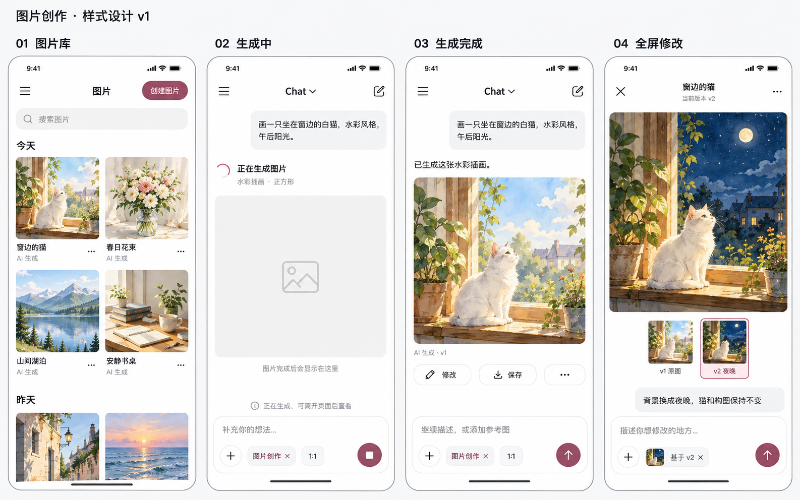

# 图片创作样式稿 v1

日期：2026-10-11（Asia/Taipei）。用户采纳生图系统建议后制作的第一版静态视觉稿，未修改业务代码。

## 场景与样式

1. 图片库：搜索、创建图片、按日期分组的双列缩略图。
2. 聊天生成中：真实状态位置、稳定占位图、图片创作标签、比例和停止入口。
3. 聊天生成完成：主图、生成标记、修改、保存及继续创作输入框。
4. 全屏修改：完整图片、版本缩略图、选中版本和基于当前版本的修改输入框。

沿用 2026-10-10 中性样式和 2026-10-11 高亮色设计。白色背景、黑灰文字、浅灰表面、细边框，默认粉色高亮。示例内容为窗边白猫水彩画，用日景 v1 与夜景 v2 表达修改关系。

## 生成与实施边界

使用内置 image_gen 生成。提示词见 [prompts.md](prompts.md)。图片中的图库条目、生成完成和夜景修改是视觉示例，不是客户端功能或接口验收证据。

实施时继续采用 Android 系统状态栏；草图中的状态栏图标不作为平台规范。保持原始图片比例，日景与夜景草图的展示尺寸差异不能视为修改后允许改变图片比例。修改是否保持主体和构图需另行验证。

深色、其他高亮色、键盘展开、大字体、空态及失败态尚未出图，实施时需适配。现有未实现功能仍以源码和验收记录为准。
